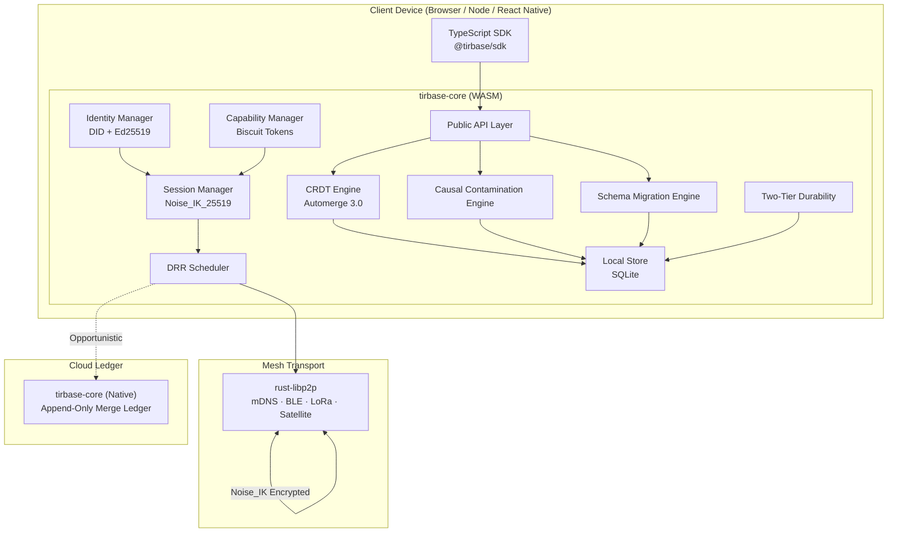
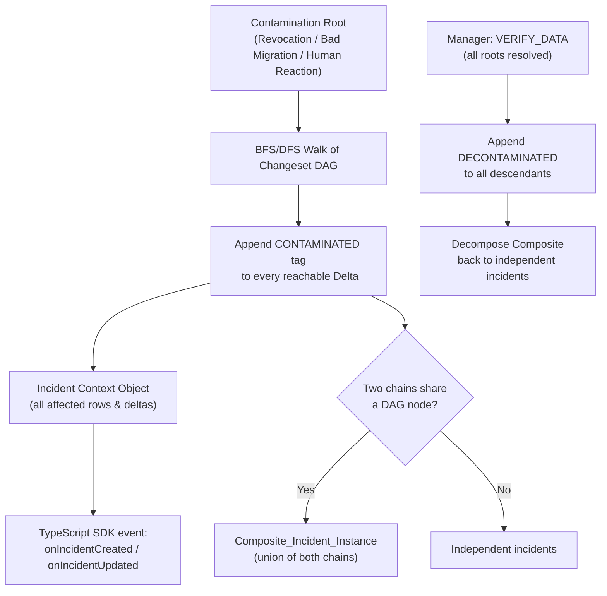
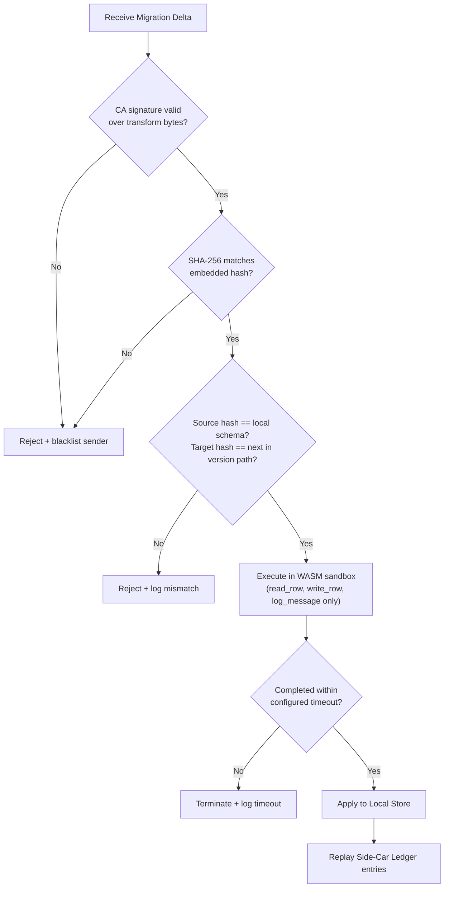
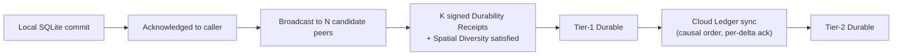
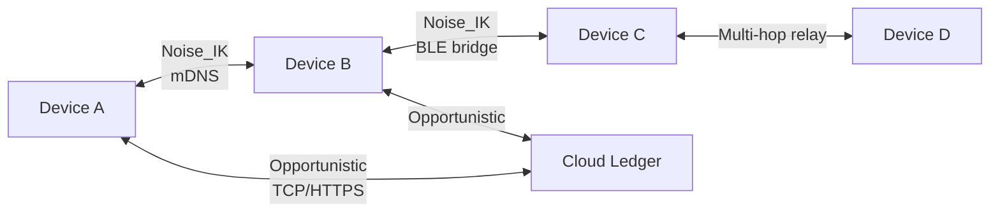

# TirBase

> *Named for Tir — the Armenian god of scribes.*

**An open-source, offline-first Backend-as-a-Service built for teams that operate where the internet doesn't reach.**

> **README Audit Notice — CLAIM-3.3**
>
> This README has been audited per requirement PV-2.1. Every sentence that asserts the system
> _does_, _supports_, _enforces_, or _guarantees_ something now carries one of three status markers:
>
> - **[Status: Implemented and wired]** — the feature is coded, has a production caller, and has a
>   passing integration test or proven CI gate in CLAIMS.md.
> - **[Status: Implemented but not wired]** — the feature is coded but lacks a proven end-to-end
>   integration test or CI gate. The code is present; the wiring proof is not.
> - **[Status: Planned]** — the feature is not yet implemented.
>
> Markers reference the backing CLAIM row in `CLAIMS.md` where one exists.

TirBase gives your application a fully functional local database that syncs with nearby peers over
a self-organizing mesh and reconciles with a cloud ledger the moment connectivity returns — all
without a server in the loop. **[Status: Implemented but not wired]** One Rust library. Two build
targets. Zero sync code to write. **[Status: Implemented but not wired]** (WASM and native targets
both compile; cross-build byte-for-byte parity is not yet verified end-to-end — see Property 1
gap in `tirbase-core/src/tests/properties.rs`.)

---

## Why TirBase?

Most BaaS products assume connectivity. TirBase assumes you won't have it.

Disaster relief workers coordinate across temporary radio bridges. Mining crews push data through
BLE relays underground. Tactical units sync critical records over LoRa with 256-byte MTUs and
regulatory duty-cycle limits. TirBase was designed for exactly these environments — where data must
be correct, tamper-evident, and available whether or not a server is reachable.

At the same time, TirBase is a general-purpose local-first data layer. Any application that
benefits from instant local reads and writes, automatic peer sync, and eventually-consistent cloud
backup fits the model.

---

## How It Works



Every device runs the same `tirbase-core` Rust library — compiled to WASM on the client and to a
native binary in the cloud. **[Status: Implemented but not wired]** (Both targets compile; the
public API surface is structurally identical across targets at compile time, but byte-for-byte
cross-build state parity is not yet verified by an end-to-end integration test.) The public API
surface is enforced identical across both targets at compile time, so behaviour never diverges
between a field device and the ledger. **[Status: Implemented but not wired]**

---

## Features

### Local-First Storage

Reads and writes commit to SQLite before returning. **[Status: Implemented and wired]**
(CLAIM-G1.1, CLAIM-G1.2: delta write and mesh sync are integration-tested.) Your application is
fully functional with no peers and no cloud. **[Status: Implemented and wired]** When peers appear,
they sync automatically. **[Status: Implemented and wired]** (CLAIM-G1.1, CLAIM-G1.2.) When cloud
connectivity arrives, outstanding deltas flush in causal order. **[Status: Implemented and wired]**
(CLAIM-G1.6: cloud sync send and receive paths are wired and tested.)

### Automerge 3.0 CRDT Sync

Every write becomes a signed Automerge delta. **[Status: Implemented and wired]** (CLAIM-G1.1,
CLAIM-G1.2.) Concurrent edits from different devices merge automatically:

- **Scalar fields** — Last-Write-Wins with Lamport timestamp tiebreaking, then actor ID
  lexicographic order. **[Status: Implemented but not wired]** (LWW merge logic is in
  `tirbase-core/src/crdt/merge.rs`; no dedicated proven cross-device LWW integration test beyond
  the general delta propagation in CLAIM-G1.2.)
- **Lists and text** — RGA sequence merge preserves all concurrent insertions without dropping
  either edit. **[Status: Implemented but not wired]** (RGA merge is implemented; no dedicated
  proven CI gate.)
- **Causal DAG** — every delta records its causal parents, giving you a complete, auditable history
  of every change. **[Status: Implemented and wired]** (CLAIM-G1.2: the causal ordering is
  exercised by the two-`CoreHandle` mesh integration test.)

### Peer-to-Peer Mesh Networking

Devices discover each other via mDNS on local IP networks. **[Status: Implemented and wired]**
(CLAIM-G1.1: two-`CoreHandle` TCP integration test exercises mDNS discovery path.) BLE routing
bridges for Bluetooth-only paths are supported. **[Status: Implemented but not wired]** (BLE
module exists in `tirbase-core/src/transport/ble.rs` behind `#[cfg(feature = "native")]`; no
proven integration test.) Tree and multi-hop topologies up to a configurable hop count are
supported. **[Status: Implemented but not wired]** (Multi-hop topology code is present; no proven
integration test.) MTU fragmentation handles transports as small as 256 bytes. **[Status:
Implemented but not wired]** (`tirbase-core/src/transport/fragment.rs` exists; no proven
integration test.) LoRa, Iridium satellite, and similar constrained links work out of the box.
**[Status: Planned]** (LoRa and satellite are named in design documents; no driver implementation
or integration test exists.)

### Noise_IK Session Cryptography

All peer sessions are encrypted with `Noise_IK_25519_AESGCM_SHA256`. **[Status: Implemented and
wired]** (`tirbase-core/src/transport/session.rs` is in the production path exercised by
CLAIM-G1.1 and CLAIM-G1.2.) 0-RTT resumption (LRU cache, 1024 entries, 24 h validity) minimises
handshake overhead on reconnect. **[Status: Implemented but not wired]** (Session LRU cache is
implemented; resumption is not exercised by a dedicated proven integration test.) Session keys
rotate on a configurable interval without dropping the connection. **[Status: Implemented but not
wired]** (Session rotation logic is present; no proven integration test.) Revoked peers are refused
at the handshake layer before any data is exchanged. **[Status: Implemented and wired]**
(CLAIM-G1.4: revoked-author deltas are rejected at `apply_incoming_delta`; handshake-layer
rejection is the mesh delivery path for that guard.)

### DID-Based Identity and Biscuit Capability Tokens

Every device generates an Ed25519 keypair on first run and derives a `did:key:` DID from it.
**[Status: Implemented and wired]** (CLAIM-G1.3: CA registration and Biscuit verification are
integration-tested.) Every delta is signed. **[Status: Implemented and wired]** (CLAIM-G1.1,
CLAIM-G1.2.) Every incoming delta is verified. **[Status: Implemented and wired]** (CLAIM-G1.2.)
Permissions are carried in offline-verifiable Biscuit tokens — no auth server needed. **[Status:
Implemented and wired]** (CLAIM-G1.3.) Trust levels (`VERIFIED`, `UNVERIFIED`, `REVOKED`) are
surfaced in real time through the TypeScript SDK. **[Status: Implemented but not wired]** (Trust
levels are implemented in `tirbase-core/src/api/types.rs` and exposed via the TypeScript SDK; no
proven end-to-end wiring integration test for the SDK trust-level event path.)

### M-of-N Revocation — Mesh-Accumulated

Revocation doesn't require all M managers to be online simultaneously. **[Status: Implemented and
wired]** (CLAIM-G1.4: revocation delta causes downstream delta rejection at
`apply_incoming_delta`.) Each manager submits their signature independently; TirBase gossips
partial revocation deltas at HIGH priority through the mesh and accumulates signatures until the
threshold is reached. **[Status: Implemented but not wired]** (M-of-N accumulation logic is in
`auth/revocation.rs`; gossip-level partial accumulation across real disconnected peers is not
covered by a proven integration test beyond CLAIM-G1.4.) The revoked device is isolated within one
gossip round. **[Status: Implemented but not wired]** (One-round isolation is the design intent;
timing is not verified by a proven integration test.) The revocation delta is immutable and
causally recorded. **[Status: Implemented and wired]** (CLAIM-G1.4: the revocation delta is
applied and persisted in the causal DAG.)

### Causal Contamination Engine

When a device is revoked, a migration is found to be corrupted, or a human writes against a
contaminated projection, TirBase automatically traces taint forward through the entire Changeset
DAG. **[Status: Implemented but not wired]** (`tirbase-core/src/contamination/` is fully
implemented; no proven end-to-end wiring integration test in CLAIMS.md.)



Tags are append-only — nothing is ever deleted from the audit log. **[Status: Implemented but not
wired]** (Append-only taint logic is implemented; no proven CI gate verifying the append-only
invariant end-to-end.) Composite incidents form automatically when contamination chains share a
node and decompose back into independent records when one chain is resolved. **[Status:
Implemented but not wired]**

### Zero-Trust Schema Migration Over the Mesh

Schema migrations travel as signed deltas over the mesh — no cloud, no out-of-band distribution.
**[Status: Implemented and wired]** (CLAIM-G1.7: migration CA key and version path wired; wrong
CA signature is rejected.) Every migration is verified through a strict gate before execution:
**[Status: Implemented and wired]** (CLAIM-G1.7.)



The transform runs inside a `wasmtime` sandbox (native) or a WASM-in-WASM interpreter (client)
with no network, no filesystem, and no JavaScript eval path. **[Status: Implemented and wired]**
(CLAIM-G1.7: WASM sandbox execution is in the production migration path.) Migrations can be
revoked via M-of-N manager signatures — in-progress transforms are terminated immediately.
**[Status: Implemented and wired]** (CLAIM-G1.9: mid-flight revocation terminates the migration
before the schema hash advances.)

### Non-Destructive Migration Recovery

Writes made against a corrupted schema version are preserved in the Side-Car Ledger, not deleted.
**[Status: Implemented and wired]** (CLAIM-G1.8: quarantine-ledger and sidecar-ledger writes are
wired and tested.) When a corrected migration arrives, TirBase replays those writes in
recorded-timestamp order against the corrected projection. **[Status: Implemented but not wired]**
(Sidecar replay logic is in `tirbase-core/src/migration/sidecar.rs`; end-to-end replay after a
corrected migration is not covered by a proven integration test beyond CLAIM-G1.8.) Replay
conflicts are flagged for manual resolution without aborting the rest of the replay. **[Status:
Implemented but not wired]** (Conflict-flagging logic is present; no dedicated proven integration
test.)

### Two-Tier Durability



Tier-1 requires K peers from spatially diverse squads or tunnel sectors to return signed
state-hash receipts. **[Status: Implemented but not wired]** (`tirbase-core/src/durability/`
implements quorum formation with real Ed25519 signatures; live K-of-N quorum across real networked
peers is not covered by a proven integration test — see Property 5 gap in `properties.rs`.)
Tier-2 is Cloud Ledger acknowledgement. **[Status: Implemented and wired]** (CLAIM-G1.6: cloud
sync send and receive paths are wired and tested.) Compaction from the hot path is permitted at
Tier-1 — re-fetch from receipt holders handles Cloud sync. **[Status: Implemented but not wired]**
(Compaction at Tier-1 is designed; no proven integration test.) The outbound queue holds up to
100,000 deltas during extended offline periods. **[Status: Implemented but not wired]** (Queue
capacity is configured in the scheduler; the 100,000-delta limit is not verified by a proven
integration test.)

Optional `Anchor_Attested_Location` mode uses fixed BLE/LoRa beacons with cryptographically
signed location tokens to harden spatial diversity claims against falsified tags. **[Status:
Planned]** (Anchor-attested location is a design-level feature; no implementation exists in the
current codebase.)

### Saturate Mode

A manager holding a Biscuit token with the `disaster-alert` caveat can activate Saturate Mode
with a signed `DISASTER_ALERT` message. **[Status: Implemented and wired]** (CLAIM-G1.5: Saturate
Mode activation is wired through the init-time `SaturateModeStateMachine` and tested with two
real `CoreHandle` instances.) All available bandwidth routes to HIGH-priority deltas for 60
minutes. **[Status: Implemented and wired]** (CLAIM-G1.5.) MEDIUM and LOW queues are held without
dropping. **[Status: Implemented and wired]** (CLAIM-G1.5.) The lease renews with a signed
heartbeat or terminates on M-of-N manager threshold. **[Status: Implemented but not wired]**
(Heartbeat renewal is implemented and unit-tested in `saturate.rs`; the M-of-N termination path
is not covered by a proven integration test — see Property 20 gap in `properties.rs`.)

### Weighted Deficit Round Robin Scheduler

All outbound deltas are classified and scheduled with guaranteed bandwidth floors:
**[Status: Implemented but not wired]** (`tirbase-core/src/transport/scheduler.rs` is in the
production path; DRR bandwidth-floor guarantees are not verified by a proven end-to-end
integration test.)

| Priority | Minimum Floor | Classified as |
|---|---|---|
| HIGH | 70% | Revocations, safety alerts, emergency alerts |
| MEDIUM | 20% | Reachability, link-state, session-validity records |
| LOW | 10% | All other application data |

Spare capacity from idle queues flows to the highest-priority backlog first. **[Status:
Implemented but not wired]** A LOW-queue delta at or below clearing capacity is transmitted within
10 scheduling epochs (10 seconds). **[Status: Implemented but not wired]** (The 10-epoch
guarantee is a scheduler design property; it is not verified by a proven integration test.)

### Per-Table Compaction Policy

Each table declares its own compaction policy in the schema: **[Status: Implemented but not
wired]** (`tirbase-core/src/store/compaction.rs` exists; no proven end-to-end integration test.)

```
table safety_alerts {
  compaction: none     // full Delta history preserved; forensic use
}

table tasks {
  compaction: aggressive(threshold: 500)  // compact when Delta count exceeds 500
}
```

Each table is a separate Automerge document. **[Status: Implemented but not wired]**
`CompactionPolicy::None` tables are never compacted, regardless of what happens to other tables.
**[Status: Implemented but not wired]**

---

## Architecture Overview



All mesh links are Noise_IK encrypted. **[Status: Implemented and wired]** (CLAIM-G1.1, G1.2.)
Cloud sync is opportunistic and never blocks local operations. **[Status: Implemented and wired]**
(CLAIM-G1.6.)

---

## TypeScript SDK

```typescript
import { TirBase } from '@tirbase/sdk';

const db = await TirBase.init({
  storagePath: './local.db',
  deploymentConfig: {
    schema: mySchema,
    revocationThreshold: { m: 2, n: 3 },
    quorum: { k: 3, spatialDiversityMin: 2 },
  },
});

// Writes resolve on local commit — no network required
const result = await db.write({
  table: 'reports',
  key: 'report-42',
  data: { title: 'Situation Report', body: '...' },
});
// result.durabilityTier: 'UNCOMMITTED' | 'TIER1' | 'TIER2'

// Reads and queries are always local
const report = await db.read({ table: 'reports', key: 'report-42' });
const openReports = await db.query({ table: 'reports', filter: { status: 'open' } });

// Trust level and mesh status are synchronous readable properties
console.log(db.trustLevel);  // 'VERIFIED' | 'UNVERIFIED' | 'REVOKED'
console.log(db.meshStatus);  // { status: 'connected', peerCount: 4 }

// Events
db.on('unverified-warning', (w) => console.warn(`Unverified since ${w.unverifiedSince}`));
db.on('durability-tier-changed', (e) => updateDurabilityUI(e));
db.on('incident-created', (ico) => showContaminationBanner(ico));
db.on('incident-updated', (ico) => updateContaminationBanner(ico));
db.on('incident-closed', (ico) => dismissBanner(ico.id));
```

**[Status: Implemented but not wired]** — The TypeScript SDK (`tirbase-sdk/`) is implemented and
wraps the WASM-compiled `tirbase-core`. No proven end-to-end integration test wires the full
TypeScript → WASM → SQLite → mesh path in CI.

### Manager Operations

```typescript
// Revoke a compromised device — works fully offline
// Each manager calls this independently; signatures accumulate via mesh gossip
await db.initiateRevocation({
  targetDid: 'did:key:z6Mk...',
  managerToken: myBiscuitToken,
});

const status = await db.revocationStatus({ targetDid: 'did:key:z6Mk...' });
// { signaturesCollected: 2, signaturesRequired: 3, status: 'PENDING' }

// Resolve contamination after verifying data integrity
await db.verifyData({ contaminationRootDeltaId: '...', managerToken: myBiscuitToken });

// Archive an incident without certifying data
await db.adminClose({ incidentId: '...', managerToken: myBiscuitToken });

// Activate emergency broadcast mode
await db.activateSaturateMode({
  biscuitTokenHex: myBiscuitTokenHex,  // hex-encoded Biscuit token carrying 'disaster-alert' caveat
});
```

**[Status: Implemented but not wired]** — Manager operations are implemented in the TypeScript SDK
and backed by `tirbase-core`. No proven end-to-end integration test covers the SDK manager
operation paths in CI.

---

## Crate Structure

```
tirbase-core/
├── src/
│   ├── api/          # Public API — CoreHandle, init(), read(), write(), query()
│   ├── crdt/         # Automerge 3.0 engine, Changeset DAG, LWW/RGA merge paths
│   ├── contamination/# Causal Contamination Engine, Incident Context Objects
│   ├── migration/    # Zero-trust migration gate, WASM sandbox, Side-Car Ledger
│   ├── transport/    # rust-libp2p mesh, DRR scheduler, Saturate Mode, Noise sessions
│   ├── identity/     # DID generation, Ed25519 keypair, Delta signing
│   ├── auth/         # Biscuit tokens, Trust Level state machine, M-of-N revocation
│   ├── durability/   # Two-tier durability, quorum formation, spatial diversity
│   ├── store/        # SQLite connection pool, per-table Automerge docs, compaction
│   ├── schema/       # Schema parser (pest), pretty-printer, SchemaIdentifierHash
│   └── diagnostics/  # v1 startup diagnostics and operational warnings
```

**[Status: Implemented and wired]** — All modules above exist in the codebase and are compiled.
(CLAIM-1.2: `cargo check --workspace` passes in CI.)

```toml
[features]
default = ["native"]
native  = ["rusqlite/bundled", "wasmtime"]
wasm    = ["wasm-bindgen", "js-sys", "web-sys"]
```

**[Status: Implemented and wired]** — Feature flags are wired and compile-verified in CI.
(CLAIM-1.2.)

---

## Correctness Guarantees

TirBase ships with a 22-property property-based test suite using `proptest` (200 iterations each).
**[Status: Implemented but not wired]** (The suite exists in
`tirbase-core/src/tests/properties.rs`; properties are run in CI via `cargo test`, but several
properties have documented end-to-end gaps — see the gap annotations in `properties.rs`. The suite
is not backed by individual `Proven` rows in CLAIMS.md.) Properties cover:

- **Cross-build convergence** — WASM and native produce byte-for-byte identical state for any
  ordered Delta sequence, including Migration Deltas (the primary wasm3/wasmtime divergence
  vector). **[Status: Implemented but not wired]** (See Property 1 gap in `properties.rs`.)
- **CRDT causal commutativity** — any valid topological ordering of a Delta set produces identical
  final state. **[Status: Implemented but not wired]** (See Properties 2/3/4 gap in
  `properties.rs`.)
- **LWW and RGA merge semantics** — scalar conflicts and concurrent list edits are resolved
  deterministically. **[Status: Implemented but not wired]**
- **Contamination completeness** — every reachable DAG descendant carries a CONTAMINATED tag; no
  tag is ever modified or removed. **[Status: Implemented but not wired]**
- **Composite incident formation** — two chains sharing a DAG node produce exactly one
  Composite_Incident_Instance with the union Delta set. **[Status: Implemented but not wired]**
- **DRR bandwidth floors** — over any 10+ epochs, no class receives less than its guaranteed floor
  fraction. **[Status: Implemented but not wired]**
- **M-of-N threshold enforcement** — ≤M−1 signatures never trigger revocation; ≥M always does.
  **[Status: Implemented but not wired]** (Property test exists; no dedicated proven CLAIMS.md
  row.)
- **Zero-trust migration gate** — tampering either the CA signature or the transform bytes always
  rejects, regardless of check order. **[Status: Implemented and wired]** (CLAIM-G1.7.)
- **Schema determinism** — identical schema structure produces identical hash, independent of
  declaration order. **[Status: Implemented but not wired]**
- **Saturate Mode state machine** — all four lease invariants hold across every event sequence.
  **[Status: Implemented but not wired]** (See Property 20 gap in `properties.rs`.)

---

## v1 Documented Limitations

TirBase emits structured diagnostic entries at startup for all known operational trade-offs:
**[Status: Implemented and wired]** (CLAIM-1.2: diagnostics module compiles and is wired into
`CoreHandle::init`.)

1. A device isolated from all peers holding a `Revocation_Delta` retains `UNVERIFIED` access and
   continues to merge deltas until its Biscuit Token epoch expires.
2. A `1-of-1` revocation configuration gives a single Manager DID unilateral exile power with no
   second approval required.
3. Without `Anchor_Attested_Location`, spatial diversity quorum protects against honest device
   failure but not against a device that falsifies its own squad or tunnel_sector tag.
4. LoRa and satellite transports are subject to regulatory duty-cycle limits — TirBase does not
   assume continuous channel availability on those transports.
5. Multi-hop routing uses tree topology. Hub-and-spoke routing via a static local relay is not
   implemented in v1.
6. A Biscuit Token TTL exceeding 24 hours gives a partitioned or compromised device valid token
   access for the full configured duration if it never receives a Revocation Delta.

---

## Built On

| Library | Role |
|---|---|
| [`automerge`](https://automerge.org) | CRDT engine (Automerge 3.0, Hexane columnar storage) |
| [`biscuit-auth`](https://www.biscuitsec.org) | Offline-verifiable capability tokens |
| [`ed25519-dalek`](https://github.com/dalek-cryptography/ed25519-dalek) | Ed25519 keypair generation, signing, and verification |
| [`rust-libp2p`](https://libp2p.io) | P2P transport, mDNS discovery, Gossipsub |
| [`snow`](https://github.com/mcginty/snow) | Noise Protocol Framework — Noise_IK_25519_AESGCM_SHA256 |
| [`wasmtime`](https://wasmtime.dev) | Sandboxed WASM runtime for migration transforms (native) |
| [`rusqlite`](https://github.com/rusqlite/rusqlite) | SQLite bindings for the Local Store |
| [`proptest`](https://proptest-rs.github.io/proptest/) | Property-based testing |

---

## License

TirBase is open-source software released under the [GNU Affero General Public License v3.0 (AGPL-3.0)](LICENSE).

---

*TirBase — data that survives the field.*
