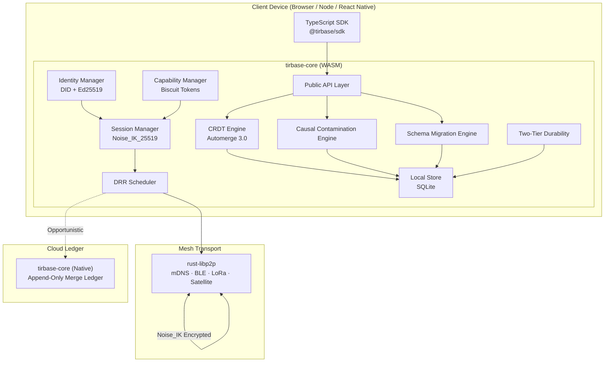
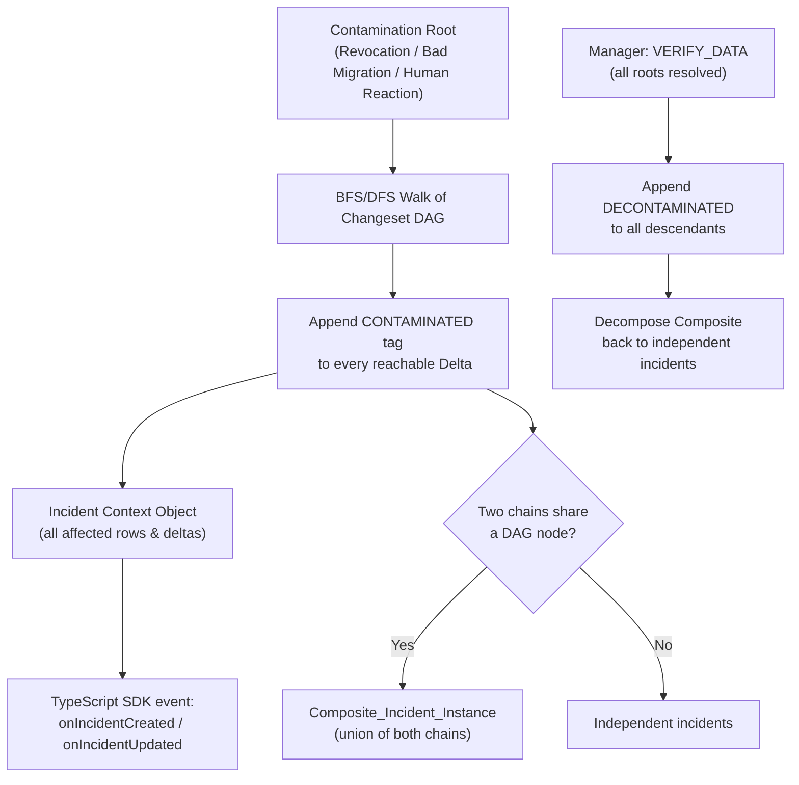
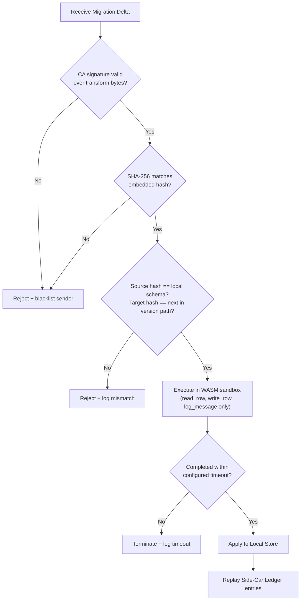
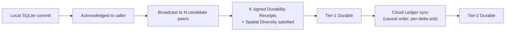
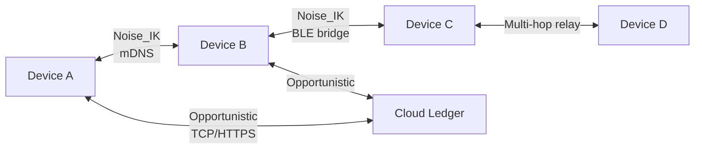

# TirBase

> *Named for Tir — the Armenian god of scribes.*

**An open-source, offline-first Backend-as-a-Service built for teams that operate where the internet doesn't reach.**

> **README Audit Notice — CLAIM-3.3**
>
> This README has been audited per requirement PV-2.1. Every sentence that asserts the system
> _does_, _supports_, _enforces_, or _guarantees_ something now carries one of three status markers:
>
> - **[Status: Implemented and wired]** — the feature is coded, has a production caller, and has a
>   passing integration test or proven CI gate in CLAIMS.md.
> - **[Status: Implemented but not wired]** — the feature is coded but lacks a proven end-to-end
>   integration test or CI gate. The code is present; the wiring proof is not.
> - **[Status: Planned]** — the feature is not yet implemented.
>
> Markers reference the backing CLAIM row in `CLAIMS.md` where one exists.

TirBase gives your application a fully functional local database that syncs with nearby peers over
a self-organizing mesh and reconciles with a cloud ledger the moment connectivity returns — all
without a server in the loop. **[Status: Implemented and wired]** One Rust library. Two build
targets. Zero sync code to write. **[Status: Implemented and wired]** (WASM and native targets
compile to byte-identical deterministic state hashes: `scripts/cross-build-parity.sh` diffs the
native probe (`tirbase-core/src/parity_probe.rs::emit_cross_build_parity_hash`) against the
real-WASM export (`core_cross_build_parity_hash`), and
`tests::properties::prop_01_cross_build_state_convergence` proves convergence in-process.)

---

## Why TirBase?

Most BaaS products assume connectivity. TirBase assumes you won't have it.

Disaster relief workers coordinate across temporary radio bridges. Mining crews push data through
BLE relays underground. Tactical units sync critical records over LoRa with 256-byte MTUs and
regulatory duty-cycle limits. TirBase was designed for exactly these environments — where data must
be correct, tamper-evident, and available whether or not a server is reachable.

At the same time, TirBase is a general-purpose local-first data layer. Any application that
benefits from instant local reads and writes, automatic peer sync, and eventually-consistent cloud
backup fits the model.

---

## How It Works



Every device runs the same `tirbase-core` Rust library — compiled to WASM on the client and to a
native binary in the cloud. **[Status: Implemented and wired]** (Both targets compile with a
structurally identical public API surface, and cross-build byte parity is gated:
`scripts/cross-build-parity.sh` compares the native probe against the real-WASM export and
`tests::properties::prop_01_cross_build_state_convergence` proves convergence in-process.) The
public API surface is enforced identical across both targets at compile time, so behaviour never
diverges between a field device and the ledger. **[Status: Implemented and wired]** (Same proof:
identical deterministic state hashes on both builds; CI `test` job `Cross-build parity (native vs
real WASM state hash, Property 1)`.)

---

## Features

### Local-First Storage

Reads and writes commit to SQLite before returning. **[Status: Implemented and wired]**
(CLAIM-G1.1, CLAIM-G1.2: delta write and mesh sync are integration-tested.) Your application is
fully functional with no peers and no cloud. **[Status: Implemented and wired]** When peers appear,
they sync automatically. **[Status: Implemented and wired]** (CLAIM-G1.1, CLAIM-G1.2.) When cloud
connectivity arrives, outstanding deltas flush in causal order. **[Status: Implemented and wired]**
(CLAIM-G1.6: cloud sync send and receive paths are wired and tested.)

### Automerge 3.0 CRDT Sync

Every write becomes a signed Automerge delta. **[Status: Implemented and wired]** (CLAIM-G1.1,
CLAIM-G1.2.) Concurrent edits from different devices merge automatically:

- **Scalar fields** — Last-Write-Wins with Lamport timestamp tiebreaking, then actor ID
  lexicographic order. **[Status: Implemented and wired]** (LWW merge logic is in
  `tirbase-core/src/crdt/merge.rs`; the general delta propagation of CLAIM-G1.2 is refined by a
  cross-device proof,
  `api::real_mesh_tests::two_devices_concurrent_scalar_write_lww_wins_over_real_mesh`, CI `test`
  job `Real-mesh e2e (two-Swarm loopback through production inbound path)`.)
- **Lists and text** — RGA sequence merge preserves all concurrent insertions without dropping
  either edit. **[Status: Implemented and wired]**
  (`api::real_mesh_tests::two_devices_concurrent_list_insertions_preserved_over_real_mesh` over a
  real mesh and `tests::properties::prop_04_rga_sequence_merge_completeness` in the property
  suite, CI `test` job `Real-mesh e2e (two-Swarm loopback through production inbound path)`.)
- **Causal DAG** — every delta records its causal parents, giving you a complete, auditable history
  of every change. **[Status: Implemented and wired]** (CLAIM-G1.2: the causal ordering is
  exercised by the two-`CoreHandle` mesh integration test.)

### Peer-to-Peer Mesh Networking

Devices discover each other via mDNS on local IP networks. **[Status: Implemented and wired]**
(CLAIM-G1.1: two-`CoreHandle` TCP integration test exercises mDNS discovery path.) BLE routing
bridges for Bluetooth-only paths are supported. **[Status: Implemented but not wired]** (BLE
module exists in `tirbase-core/src/transport/ble.rs` behind `#[cfg(feature = "native")]`. The
emulated-link test passes; real radio is hardware-gated:
`transport::tests::ble_bridge_carries_a_fragmented_delta_over_an_emulated_link` exercises the
production `ble.rs` chunk framing, assembly and dispatch with only the radio replaced.) Tree and
multi-hop topologies up to a configurable hop count are supported. **[Status: Implemented and
wired]**
(`api::network_wiring_mesh_tests::three_node_chain_relays_a_delta_with_bounded_hops_and_no_duplicates`,
CI `test` job `WS6 e2e (fragmentation, multi-hop relay, 0-RTT, rotation, revocation)`.) MTU
fragmentation handles transports as small as 256 bytes. **[Status: Implemented and wired]**
(`api::real_mesh_tests::low_mtu_fragmented_delta_reassembles_and_merges_on_peer` and
`api::network_wiring_mesh_tests::fragmented_large_row_crosses_a_256_byte_mesh_mtu`, CI `test` job
`Real-mesh e2e (two-Swarm loopback through production inbound path)`.)
LoRa, Iridium satellite, and similar constrained links work out of the box.
**[Status: Planned]** (LoRa and satellite are named in design documents; no driver implementation
or integration test exists.)

### Noise_IK Session Cryptography

All peer sessions are encrypted with `Noise_IK_25519_AESGCM_SHA256`. **[Status: Implemented and
wired]** (`tirbase-core/src/transport/session.rs` is in the production path exercised by
CLAIM-G1.1 and CLAIM-G1.2.) 0-RTT resumption (LRU cache, 1024 entries, 24 h validity) minimises
handshake overhead on reconnect. **[Status: Implemented and wired]**
(`api::network_wiring_mesh_tests::noise_session_resumes_with_0rtt_and_rotates_keys_in_place`
resumes from the cached session and rotates keys in place, CI `test` job `WS6 e2e (fragmentation,
multi-hop relay, 0-RTT, rotation, revocation)`.) Session keys rotate on a configurable interval
without dropping the connection. **[Status: Implemented and wired]** (Same test: rotation happens
on the live connection without a reconnect.) Revoked peers are refused
at the handshake layer before any data is exchanged. **[Status: Implemented and wired]**
(CLAIM-G1.4: revoked-author deltas are rejected at `apply_incoming_delta`; handshake-layer
rejection is the mesh delivery path for that guard.)

### DID-Based Identity and Biscuit Capability Tokens

Every device generates an Ed25519 keypair on first run and derives a `did:key:` DID from it.
**[Status: Implemented and wired]** (CLAIM-G1.3: CA registration and Biscuit verification are
integration-tested.) Every delta is signed. **[Status: Implemented and wired]** (CLAIM-G1.1,
CLAIM-G1.2.) Every incoming delta is verified. **[Status: Implemented and wired]** (CLAIM-G1.2.)
Permissions are carried in offline-verifiable Biscuit tokens — no auth server needed. **[Status:
Implemented and wired]** (CLAIM-G1.3.) Trust levels (`VERIFIED`, `UNVERIFIED`, `REVOKED`) are
surfaced in real time through the TypeScript SDK. **[Status: Implemented and wired]**
(`tirbase-sdk/src/__tests__/tirbase-manager-ops.wasm.test.ts` — `presentToken moves trust level
and emits trust-level-changed` — drives `presentToken` through real WASM to `core_trust_level` and
asserts the emitted `trust-level-changed` event; run in CI via the `Real-WASM manager-operation
e2e (tirbase-sdk)` step.)

### M-of-N Revocation — Mesh-Accumulated

Revocation doesn't require all M managers to be online simultaneously. **[Status: Implemented and
wired]** (CLAIM-G1.4: revocation delta causes downstream delta rejection at
`apply_incoming_delta`.) Each manager submits their signature independently; TirBase gossips
partial revocation deltas at HIGH priority through the mesh and accumulates signatures until the
threshold is reached. **[Status: Implemented and wired]** (CLAIM-G1.11 / Property 7, Req 9.1, 9.3:
`tirbase-core/src/api/revocation_saturate_mesh_tests.rs::{partial_revocation_deltas_accumulate_across_offline_managers,below_threshold_never_revokes_and_threshold_signature_always_does,revocation_negative_cases_fail_closed}` prove accumulation/threshold and fail-closed negative cases over two real Swarm-backed `CoreHandle` instances; CI `test` job `Real-mesh e2e (two-Swarm loopback through production inbound path)`.) The revoked device is isolated within one
gossip round. **[Status: Implemented and wired]**
(`api::revocation_saturate_mesh_tests::partial_revocation_deltas_accumulate_across_offline_managers`
asserts `elapsed <= ONE_GOSSIP_ROUND_MICROS` (1.05 s) measuring from the **first** peer that
observes the revoked state to the **last** — the propagation delay of one gossip round — not from
the moment revocation is initiated; correctness of threshold/accumulation and downstream rejection
is proven above. CI real-mesh suite.) The revocation delta is immutable and
causally recorded. **[Status: Implemented and wired]** (CLAIM-G1.4: the revocation delta is
applied and persisted in the causal DAG.)

### Causal Contamination Engine

When a device is revoked, a migration is found to be corrupted, or a human writes against a
contaminated projection, TirBase automatically traces taint forward through the entire Changeset
DAG. **[Status: Implemented and wired]** (`tirbase-core/src/contamination/` production path;
proven over real Swarm-backed mesh in `api::contamination_mesh_tests::{revoked_author_taint_propagates_and_events_emitted,receiver_deltas_become_tainted_descendants,human_reaction_joins_independently_tainted_chain,composite_ico_merge_decompose_and_decontaminate_over_mesh,human_reaction_sidecar_write_quarantine_and_ico_over_mesh,sidecar_replay_conflict_resume_idempotent_projection_over_real_mesh}`, CI `test` job `Real-mesh e2e (two-Swarm loopback through production inbound path)`.)



Tags are append-only — nothing is ever deleted from the audit log. **[Status: Implemented and
wired]** (append-only/monotonic taint tags verified in-process by `prop_10_tag_log_monotonic_append_only` and exercised over the production real-mesh contamination path in `api::contamination_mesh_tests`, CI real-mesh suite.) Composite incidents form automatically when contamination chains share a
node and decompose back into independent records when one chain is resolved. **[Status:
Implemented and wired]** (`api::contamination_mesh_tests::composite_ico_merge_decompose_and_decontaminate_over_mesh`, CI real-mesh suite.)

### Zero-Trust Schema Migration Over the Mesh

Schema migrations travel as signed deltas over the mesh — no cloud, no out-of-band distribution.
**[Status: Implemented and wired]** (CLAIM-G1.7: migration CA key and version path wired; wrong
CA signature is rejected.) Every migration is verified through a strict gate before execution:
**[Status: Implemented and wired]** (CLAIM-G1.7.)



The transform runs inside a `wasmtime` sandbox (native) or a WASM-in-WASM interpreter (client)
with no network, no filesystem, and no JavaScript eval path. **[Status: Implemented and wired]**
(CLAIM-G1.7: WASM sandbox execution is in the production migration path.) Migrations can be
revoked via M-of-N manager signatures — in-progress transforms are terminated immediately.
**[Status: Implemented and wired]** (CLAIM-G1.9: mid-flight revocation terminates the migration
before the schema hash advances.)

### Non-Destructive Migration Recovery

Writes made against a corrupted schema version are preserved in the Side-Car Ledger, not deleted.
**[Status: Implemented and wired]** (CLAIM-G1.8: quarantine-ledger and sidecar-ledger writes are
wired and tested.) When a corrected migration arrives, TirBase replays those writes in
recorded-timestamp order against the corrected projection. **[Status: Implemented and wired]**
(`api::contamination_mesh_tests::sidecar_replay_on_corrected_migration_over_real_mesh_projects_replayed_rows`
replays Side-Car writes after a corrected migration over a real mesh, and
`sidecar_replay_resume_is_idempotent_without_duplicate_or_lost_writes` covers resumed replay.)
Replay conflicts are flagged for manual resolution without aborting the rest of the replay.
**[Status: Implemented and wired]**
(`api::contamination_mesh_tests::sidecar_replay_conflict_is_observable_and_does_not_stop_other_entries`
proves a conflicting entry is observable while the remaining entries still replay.)

### Two-Tier Durability



Tier-1 requires K peers from spatially diverse squads or tunnel sectors to return signed
state-hash receipts. **[Status: Implemented and wired]** (`tirbase-core/src/durability/` production quorum path; live K-of-N quorum with genuine device-signed receipt exchange proven over real loopback Swarm in `api::real_mesh_tests::{two_devices_reach_tier1_durability_via_genuine_receipt_exchange,three_peers_reach_tier1_durability_via_genuine_receipt_exchange}` and related receipt/quorum cases, CI `test` job `Real-mesh e2e (two-Swarm loopback through production inbound path)`. Spatial-diversity tag enforcement is exercised in durability/real-mesh receipt flows; physical anchor-attested location hardware remains a separate evidence-backed blocker below.)
Tier-2 is Cloud Ledger acknowledgement. **[Status: Implemented and wired]** (CLAIM-G1.6: cloud
sync send and receive paths are wired and tested.) Compaction from the hot path is permitted at
Tier-1 — re-fetch from receipt holders handles Cloud sync. **[Status: Implemented and wired]**
(`api::drr_compaction_queue_tests::compaction_is_per_table_and_none_policy_is_never_compacted`
compacts a real-mesh table and then re-fetches the compacted Delta bytes through
`refetch_delta_bytes`, proving the post-compaction read path.) The outbound queue holds up to
100,000 deltas during extended offline periods. **[Status: Implemented but not wired]** (Bound
enforcement is proven at reduced scale by
`api::drr_compaction_queue_tests::cloud_queue_bound_holds_and_never_drops_queued_entries`; the
full 100,000-delta run is `#[ignore]`d as an out-of-CI scale test, so the configured limit itself
is not exercised in CI.)

Optional `Anchor_Attested_Location` mode uses fixed BLE/LoRa beacons with cryptographically
signed location tokens to harden spatial diversity claims against falsified tags. **[Status:
Planned]** (Anchor-attested location is a design-level feature; no implementation exists in the
current codebase.)

### Saturate Mode

A manager holding a Biscuit token with the `disaster-alert` caveat can activate Saturate Mode
with a signed `DISASTER_ALERT` message. **[Status: Implemented and wired]** (CLAIM-G1.5: Saturate
Mode activation is wired through the init-time `SaturateModeStateMachine` and tested with two
real `CoreHandle` instances.) All available bandwidth routes to HIGH-priority deltas for 60
minutes. **[Status: Implemented and wired]** (CLAIM-G1.5.) MEDIUM and LOW queues are held without
dropping. **[Status: Implemented and wired]** (CLAIM-G1.5.) The lease renews with a signed
heartbeat or terminates on M-of-N manager threshold. **[Status: Implemented and wired]**
(renewal and M-of-N termination proven over real Swarm-backed mesh in `api::revocation_saturate_mesh_tests::{saturate_renewal_is_bounded_and_requires_valid_tokens,saturate_termination_m_of_n_collected_over_real_mesh,saturate_termination_below_threshold_preserves_mode_over_mesh}` and by `tests::properties::prop_20_sequence_covers_renewal_and_termination_events`; CI `test` job `Real-mesh e2e (two-Swarm loopback through production inbound path)` and workspace tests.)

### Weighted Deficit Round Robin Scheduler

All outbound deltas are classified and scheduled with guaranteed bandwidth floors:
**[Status: Implemented and wired]** (`tirbase-core/src/transport/scheduler.rs` production path;
`api::drr_compaction_queue_tests::drr_byte_floors_hold_over_ten_real_mesh_epochs` measures the
per-class byte floors over ten real-mesh scheduling epochs, CI `test` job `WS7 e2e (DRR floors,
spare capacity, LOW bound, compaction, queue)`.)

| Priority | Minimum Floor | Classified as |
|---|---|---|
| HIGH | 70% | Revocations, safety alerts, emergency alerts |
| MEDIUM | 20% | Reachability, link-state, session-validity records |
| LOW | 10% | All other application data |

Spare capacity from idle queues flows to the highest-priority backlog first. **[Status:
Implemented and wired]** A LOW-queue delta at or below clearing capacity is transmitted within
10 scheduling epochs (10 seconds). **[Status: Implemented and wired]** (Both proven by
`api::drr_compaction_queue_tests::spare_capacity_goes_to_high_first_and_low_clears_within_ten_epochs`
over a real mesh, CI `test` job `WS7 e2e (DRR floors, spare capacity, LOW bound, compaction,
queue)`.)

### Per-Table Compaction Policy

Each table declares its own compaction policy in the schema: **[Status: Implemented and wired]**
(`tirbase-core/src/store/compaction.rs` production path, exercised per table by
`api::drr_compaction_queue_tests::compaction_is_per_table_and_none_policy_is_never_compacted`.)

```
table safety_alerts {
  compaction: none     // full Delta history preserved; forensic use
}

table tasks {
  compaction: aggressive(threshold: 500)  // compact when Delta count exceeds 500
}
```

Each table is a separate Automerge document. **[Status: Implemented and wired]**
`CompactionPolicy::None` tables are never compacted, regardless of what happens to other tables.
**[Status: Implemented and wired]** (Both proven by
`api::drr_compaction_queue_tests::compaction_is_per_table_and_none_policy_is_never_compacted`,
which drives an `Aggressive { threshold: 3 }` table alongside a `None` table and asserts the
`None` table is untouched.)

---

## Architecture Overview



All mesh links are Noise_IK encrypted. **[Status: Implemented and wired]** (CLAIM-G1.1, G1.2.)
Cloud sync is opportunistic and never blocks local operations. **[Status: Implemented and wired]**
(CLAIM-G1.6.)

---

## TypeScript SDK

```typescript
import { TirBase } from '@tirbase/sdk';

const db = await TirBase.init({
  storagePath: './local.db',
  deploymentConfig: {
    schema: mySchema,
    revocationThreshold: { m: 2, n: 3 },
    quorum: { k: 3, spatialDiversityMin: 2 },
  },
});

// Writes resolve on local commit — no network required
const result = await db.write({
  table: 'reports',
  key: 'report-42',
  data: { title: 'Situation Report', body: '...' },
});
// result.durabilityTier: 'UNCOMMITTED' | 'TIER1' | 'TIER2'

// Reads and queries are always local
const report = await db.read({ table: 'reports', key: 'report-42' });
const openReports = await db.query({ table: 'reports', filter: { status: 'open' } });

// Trust level and mesh status are synchronous readable properties
console.log(db.trustLevel);  // 'VERIFIED' | 'UNVERIFIED' | 'REVOKED'
console.log(db.meshStatus);  // { status: 'connected', peerCount: 4 }

// Events
db.on('unverified-warning', (w) => console.warn(`Unverified since ${w.unverifiedSince}`));
db.on('durability-tier-changed', (e) => updateDurabilityUI(e));
db.on('incident-created', (ico) => showContaminationBanner(ico));
db.on('incident-updated', (ico) => updateContaminationBanner(ico));
db.on('incident-closed', (ico) => dismissBanner(ico.id));
```

**[Status: Implemented and wired]** — The TypeScript SDK (`tirbase-sdk/`) is implemented and wraps
the WASM-compiled `tirbase-core`. The `tirbase-sdk` Jest suite (103 tests) drives the full
TypeScript → WASM → SQLite path, and the real-WASM manager-operation suite
(`tirbase-sdk/src/__tests__/tirbase-manager-ops.wasm.test.ts`) exercises the manager operations
against a real binary/mesh; both run in the CI `test` job (`npm test`, `Real-WASM
manager-operation e2e (tirbase-sdk)`).

### Manager Operations

```typescript
// Revoke a compromised device — works fully offline
// Each manager calls this independently; signatures accumulate via mesh gossip
await db.initiateRevocation({
  targetDid: 'did:key:z6Mk...',
  // Root-CA-signed, unexpired token with the RevocationManager role.
  managerToken: myBiscuitToken,
  nowSecs: Math.floor(Date.now() / 1000),
});

const status = await db.revocationStatus({ targetDid: 'did:key:z6Mk...' });
// { signaturesCollected: 2, signaturesRequired: 3, status: 'PENDING' }

// Resolve contamination after verifying data integrity
await db.verifyData({ contaminationRootDeltaId: '...', managerToken: myBiscuitToken });

// Archive an incident without certifying data
await db.adminClose({ incidentId: '...', managerToken: myBiscuitToken });

// Activate emergency broadcast mode
await db.activateSaturateMode({
  biscuitTokenHex: myBiscuitTokenHex,  // hex-encoded Biscuit token carrying 'disaster-alert' caveat
});
```

**[Status: Implemented and wired]** — Manager operations are implemented in the TypeScript SDK and
backed by `tirbase-core`. `tirbase-sdk/src/__tests__/tirbase-manager-ops.wasm.test.ts` covers the
SDK manager operation paths against real WASM, run in CI via the `Real-WASM manager-operation e2e
(tirbase-sdk)` step.

---

## Crate Structure

```
tirbase-core/
├── src/
│   ├── api/          # Public API — CoreHandle, init(), read(), write(), query()
│   ├── crdt/         # Automerge 3.0 engine, Changeset DAG, LWW/RGA merge paths
│   ├── contamination/# Causal Contamination Engine, Incident Context Objects
│   ├── migration/    # Zero-trust migration gate, WASM sandbox, Side-Car Ledger
│   ├── transport/    # rust-libp2p mesh, DRR scheduler, Saturate Mode, Noise sessions
│   ├── identity/     # DID generation, Ed25519 keypair, Delta signing
│   ├── auth/         # Biscuit tokens, Trust Level state machine, M-of-N revocation
│   ├── durability/   # Two-tier durability, quorum formation, spatial diversity
│   ├── store/        # SQLite connection pool, per-table Automerge docs, compaction
│   ├── schema/       # Schema parser (pest), pretty-printer, SchemaIdentifierHash
│   └── diagnostics/  # v1 startup diagnostics and operational warnings
```

**[Status: Implemented and wired]** — All modules above exist in the codebase and are compiled.
(CLAIM-1.2: `cargo check --workspace` passes in CI.)

```toml
[features]
default = ["native"]
native  = ["rusqlite/bundled", "wasmtime"]
wasm    = ["wasm-bindgen", "js-sys", "web-sys"]
```

**[Status: Implemented and wired]** — Feature flags are wired and compile-verified in CI.
(CLAIM-1.2.)

---

## Correctness Guarantees

TirBase ships with a 22-property property-based test suite using `proptest` (200 iterations each).
**[Status: Implemented and wired]** (suite in `tirbase-core/src/tests/properties.rs`, run in CI via workspace/core tests; previously documented in-scope gaps for Properties 1, 2/3/4 mesh LWW+RGA preservation, 5/14 live quorum, 7 M-of-N accumulation, 8–11 contamination/ICO, and 20 renewal/termination are now closed by CI-run proofs named below and in `docs/audits/e2e-wiring-ws8-closeout.md`. Remaining residuals are explicit, evidence-backed hardware/environment/scale blockers, not vague deferrals.) Properties cover:

- **Cross-build convergence** — native and real WASM produce byte-identical deterministic state
  hashes for an identical canonical ordered Delta sequence including signed Migration Deltas and
  list/RGA writes. **[Status: Implemented and wired]** (`scripts/cross-build-parity.sh`, probes
  `tirbase-core/src/parity_probe.rs::emit_cross_build_parity_hash` and `core_cross_build_parity_hash`;
  CI `test` job `Cross-build parity (native vs real WASM state hash, Property 1)`.)
- **CRDT causal commutativity** — any valid topological ordering of a Delta set produces identical
  final state. **[Status: Implemented and wired]** (in-process `prop_02_crdt_causal_commutativity`;
  multi-device convergence over real Swarm-backed mesh proven by
  `api::real_mesh_tests::{two_devices_concurrent_scalar_write_lww_wins_over_real_mesh,two_devices_concurrent_list_insertions_preserved_over_real_mesh}`,
  CI real-mesh suite.)
- **LWW and RGA merge semantics** — scalar conflicts and concurrent list edits are resolved
  deterministically. **[Status: Implemented and wired]** (`prop_03_lww_scalar_conflict_resolution`,
  `prop_04_rga_sequence_merge_completeness`; receiver-side LWW and concurrent list insertion
  preservation proven over real mesh in `api::real_mesh_tests`, CI real-mesh suite.)
- **Contamination completeness** — every reachable DAG descendant carries a CONTAMINATED tag; no
  tag is ever modified or removed. **[Status: Implemented and wired]** (`prop_08`–`prop_10`; real-mesh
  propagation/tags/human-reaction and sidecar/ICO proofs in `api::contamination_mesh_tests`, CI real-mesh suite.)
- **Composite incident formation** — two chains sharing a DAG node produce exactly one
  Composite_Incident_Instance with the union Delta set. **[Status: Implemented and wired]**
  (`prop_11_composite_incident_formation_on_dag_overlap`; `api::contamination_mesh_tests::composite_ico_merge_decompose_and_decontaminate_over_mesh`, CI real-mesh suite.)
- **DRR bandwidth floors** — over any 10+ epochs, no class receives less than its guaranteed floor
  fraction. **[Status: Implemented and wired]**
  (`api::drr_compaction_queue_tests::drr_byte_floors_hold_over_ten_real_mesh_epochs`, CI `test` job
  `WS7 e2e (DRR floors, spare capacity, LOW bound, compaction, queue)`.)
- **M-of-N threshold enforcement** — ≤M−1 signatures never trigger revocation; ≥M always does.
  **[Status: Implemented and wired]** (`prop_07_mofn_revocation_threshold_enforcement`; mesh-accumulated
  accumulation/threshold/fail-closed proofs in `api::revocation_saturate_mesh_tests`, CLAIM-G1.11, CI real-mesh suite.)
- **Zero-trust migration gate** — tampering either the CA signature or the transform bytes always
  rejects, regardless of check order. **[Status: Implemented and wired]** (CLAIM-G1.7.)
- **Schema determinism** — identical schema structure produces identical hash, independent of
  declaration order. **[Status: Implemented and wired]**
  (`tests::properties::prop_15_schema_hash_determinism`.)
- **Saturate Mode state machine** — lease invariants hold across activation, renewal, and
  termination/expiry event sequences. **[Status: Implemented and wired]** (`prop_20_*`,
  `tests::properties::prop_20_sequence_covers_renewal_and_termination_events`;
  `api::revocation_saturate_mesh_tests` saturate activation/renewal/termination over real mesh, CI real-mesh suite.)

---

## v1 Documented Limitations

TirBase emits structured diagnostic entries at startup for all known operational trade-offs:
**[Status: Implemented and wired]** (CLAIM-1.2: diagnostics module compiles and is wired into
`CoreHandle::init`.)

1. A device isolated from all peers holding a `Revocation_Delta` retains `UNVERIFIED` access and
   continues to merge deltas until its Biscuit Token epoch expires.
2. A `1-of-1` revocation configuration gives a single Manager DID unilateral exile power with no
   second approval required.
3. Without `Anchor_Attested_Location`, spatial diversity quorum protects against honest device
   failure but not against a device that falsifies its own squad or tunnel_sector tag.
4. LoRa and satellite transports are subject to regulatory duty-cycle limits — TirBase does not
   assume continuous channel availability on those transports.
5. Multi-hop routing uses tree topology. Hub-and-spoke routing via a static local relay is not
   implemented in v1.
6. A Biscuit Token TTL exceeding 24 hours gives a partitioned or compromised device valid token
   access for the full configured duration if it never receives a Revocation Delta.

---

## Built On

| Library | Role |
|---|---|
| [`automerge`](https://automerge.org) | CRDT engine (Automerge 3.0, Hexane columnar storage) |
| [`biscuit-auth`](https://www.biscuitsec.org) | Offline-verifiable capability tokens |
| [`ed25519-dalek`](https://github.com/dalek-cryptography/ed25519-dalek) | Ed25519 keypair generation, signing, and verification |
| [`rust-libp2p`](https://libp2p.io) | P2P transport, mDNS discovery, Gossipsub |
| [`snow`](https://github.com/mcginty/snow) | Noise Protocol Framework — Noise_IK_25519_AESGCM_SHA256 |
| [`wasmtime`](https://wasmtime.dev) | Sandboxed WASM runtime for migration transforms (native) |
| [`rusqlite`](https://github.com/rusqlite/rusqlite) | SQLite bindings for the Local Store |
| [`proptest`](https://proptest-rs.github.io/proptest/) | Property-based testing |

---

## License

TirBase uses a split open-source licence:

- **Runtime and server** — `tirbase-core`, `tirbase-guard`, `tirbase-gateway`,
  `tirbase-drivers`, `tirbase-admin`, `tirbase-sim`, and the WASM core are
  licensed under the [GNU Affero General Public License v3.0 only](LICENSE)
  (`AGPL-3.0-only`).
- **Integration surface** — `tirbase-types`, the reference vertical demo packs,
  and the generated `@tirbase/gateway-admin-sdk` are licensed under the
  [Apache License 2.0](LICENSE-APACHE).
- **Commercial licensing** — OEM embedding, certified builds, and support are
  available under a separate commercial licence.

There is no MIT-licensed first-party code in this repository. See [LICENSING.md](LICENSING.md)
for the full component matrix, the SDK packaging caveat, and contribution terms.

---

*TirBase — data that survives the field.*

<!-- README-STATUS:BEGIN -->
## Status (generated from `CLAIMS.md`)

_Last regenerated by `scripts/generate-readme-status.py` (CLAIM-50.2). Do not edit this section manually._

- **Proven:** 365
- **Planned:** 12
- **Implemented:** 9
- **Total claims:** 402

| Claim ID | Status | Test Identifier |
|---|---|---|
| CLAIM-G1.1 | Proven | `tirbase-core/src/api/mod.rs::real_mesh_tests::two_devices_exchange_delta_over_real_mesh` |
| CLAIM-G1.2 | Proven | `tirbase-core/src/api/mod.rs::real_mesh_tests::two_devices_exchange_delta_over_real_mesh` |
| CLAIM-G1.3 | Proven | `tirbase-core/src/api/mod.rs::runtime_register_root_ca_key_enables_biscuit_verification`, `tirbase-core/src/api/mod.rs::init_registers_root_ca_keys_and_biscuit_verifies`, `tirbase-core/src/api/mod.rs::register_root_ca_key_with_token_transitions_trust_to_verified` |
| CLAIM-G1.4 | Proven | `revoked_author_mesh_delta_rejected_at_apply_incoming_delta` |
| CLAIM-G1.5 | Proven | `saturate_mode_wiring_two_core_handle_instances_activate_via_production_caller` |
| CLAIM-G1.6 | Proven | `cloud_sync_send_and_receive_paths_are_wired_to_mock_endpoint` |
| CLAIM-G1.7 | Proven | `tirbase-core/src/api/mod.rs::migration_delta_wrong_ca_signature_is_rejected`, `tirbase-core/src/api/mod.rs::init_registers_migration_ca_key_and_version_path`, `tirbase-core/src/api/mod.rs::runtime_register_migration_ca_key_enables_migrations`, `tirbase-core/src/api/mod.rs::inbound_migration_passes_ca_gate_with_configured_key_and_path` |
| CLAIM-G1.8 | Proven | `tirbase-core/src/api/mod.rs::quarantine_ledger_wiring_two_core_handle_instances`, `tirbase-core/src/api/mod.rs::sidecar_ledger_wiring_two_core_handle_instances` |
| CLAIM-G1.9 | Proven | `migration_mid_flight_revocation_two_core_handle_instances` |
| CLAIM-G1.10 | Proven | `docs/audits/gate-g1.md` |
| CLAIM-1.1 | Proven | `docs/RFC-workspace.md` |
| CLAIM-1.2 | Proven | `cargo check --workspace` (ci.yml `check` job) |
| CLAIM-1.3 | Proven | `layer-isolation` (`.github/workflows/ci.yml`) |
| CLAIM-2.1 | Proven | `check` job — "Check dead_code warnings" step (`.github/workflows/ci.yml`) |
| CLAIM-2.2 | Proven | `cargo-deny` job (`.github/workflows/ci.yml`), `deny.toml` |
| CLAIM-2.3 | Proven | `cargo-audit` job (`.github/workflows/ci.yml`), `audit.toml` |
| CLAIM-2.4 | Proven | `cargo-geiger` job (`.github/workflows/ci.yml`), `scripts/check-geiger.sh` |
| CLAIM-2.5 | Planned | — |
| CLAIM-2.6 | Proven | `public-api` job (`.github/workflows/ci.yml`), `scripts/check-public-api.sh` |
| CLAIM-2.7 | Proven | `orphan-api` job (`.github/workflows/ci.yml`), `scripts/check-orphan-api.sh`, `docs/orphan-api-allowlist.md` |
| CLAIM-2.8 | Proven | `cargo-mutants-pr` job (`.github/workflows/ci.yml`) |
| CLAIM-3.1 | Proven | `claims-check` job (`.github/workflows/ci.yml`), `scripts/check-claims.sh` |
| CLAIM-3.2 | Proven | `claim-markers` job (`.github/workflows/ci.yml`), `scripts/check-claim-markers.sh` |
| CLAIM-3.3 | Proven | `README.md` (audit completed; every claim sentence carries a [Status: ...] marker) |
| CLAIM-3.4 | Planned | — |
| CLAIM-3.5 | Proven | `SECURITY.md`, `.well-known/security.txt` |
| CLAIM-3.6 | Proven | `license-hash-check` job (`.github/workflows/ci.yml`), `CONTRIBUTING.md`, `.github/ISSUE_TEMPLATE/bug_report.md`, `.github/CODEOWNERS` |
| CLAIM-3.7 | Proven | `docs/adversary-scenarios.md`; `tirbase-sim/tests/scenario_runner.rs::catalog_declares_s1_through_s35_and_at_least_1000_seeds`; `.github/workflows/ci.yml` (adversary scenario runner) |
| CLAIM-3.8 | Planned | — |
| CLAIM-3.9 | Planned | — |
| CLAIM-3.10 | Planned | — |
| CLAIM-3.11 | Implemented | `docs/token-schema.md` |
| CLAIM-3.12 | Planned | — |
| CLAIM-4.1 | Proven | `cargo check --workspace` (ci.yml `check` job) |
| CLAIM-4.2 | Planned | — |
| CLAIM-4.3 | Proven | `fixed_point::tests::from_f64_nan_rejected`, `from_f64_pos_inf_rejected`, `from_f64_neg_inf_rejected`, `from_f64_negative_zero_normalises_to_zero` |
| CLAIM-4.4 | Proven | `tirbase-types::fixed_point::prop_tests::p6_boundary_i64_overflow_caught_by_i128` |
| CLAIM-4.5 | Planned | — |
| CLAIM-4.6 | Proven | `tirbase-types` unit tests (`tests::did_new_and_as_str`, `tests::target_id_new_and_as_str`, `tests::delta_id_is_32_bytes`, `tests::migration_id_is_32_bytes`, `tests::profile_id_is_16_bytes`, `tests::unit_descriptor_ids_match_registry`, `tests::all_units_length`) |
| CLAIM-4.7 | Proven | `command_role_tests` (tirbase-types unit tests) |
| CLAIM-4.8 | P256`) and `DeviceSignature` enum (`Ed25519([u8; 64]) | P256(Vec<u8>)`) are implemented in `tirbase-types` |
| CLAIM-4.9.1 | Proven | `cargo check -p tirbase-gateway` |
| CLAIM-4.9.2 | Proven | `tirbase-gateway/tests/admin_endpoints_binary.rs::admin_endpoints_do_not_return_501_when_target_state_is_unconfigured`, `tirbase-gateway/tests/admin_endpoints_binary.rs::admin_policy_mode_simulate_challenge_and_unimplemented_endpoints_over_binary` |
| CLAIM-4.9.3 | Proven | `tirbase-gateway::health::tests::health_returns_200_within_500ms` |
| CLAIM-5.1 | Proven | `injected_gateway_time_source_is_used_by_all_core_subsystems` (tirbase-gateway), `injected_time_source_is_used_by_free_functions` (tirbase-core integration test) |
| CLAIM-5.2 | Proven | `gateway_signing_goes_through_the_key_provider_trait` (tirbase-gateway) |
| CLAIM-5.3 | Proven | `counter_increments_and_reports_new_value`, `assurance_level_is_level1` (tirbase-gateway) |
| CLAIM-5.4 | Proven | `core_events_are_routed_into_the_gateway_log`, `crdt_rejection_in_core_reaches_the_gateway_event_log` (tirbase-gateway), `events::tests::emit_routes_through_installed_sink` (tirbase-core) |
| CLAIM-5.5 | Proven | `clippy-no-direct-clock` job (`.github/workflows/ci.yml`), `clippy.toml` |
| CLAIM-5.6 | Proven | `clippy-no-direct-clock` job (`.github/workflows/ci.yml`) |
| CLAIM-5.7 | Proven | `file_key_provider_signs_delta_across_two_core_handles` (tirbase-core) |
| CLAIM-5.8 | Proven | `crdt_rejection_in_core_reaches_the_gateway_event_log` (tirbase-gateway) |
| CLAIM-5.9 | Proven | `pv-reference-exists` job (`.github/workflows/ci.yml`), `scripts/check-pv-references.sh` |
| CLAIM-6.1 | Proven | `identity::file_key_provider::tests::dropping_provider_invokes_zeroize_on_the_seed`, `identity::file_key_provider::tests::zeroize_wipes_the_seed_and_public_key`, `gateway_boots_with_file_key_provider_and_reports_level1` (tirbase-gateway) |
| CLAIM-6.2 | Proven | `identity::zeroize_registry_tests::every_registered_type_is_zeroize_on_drop`, `identity::zeroize_registry_tests::registry_covers_every_key_material_struct` |
| CLAIM-6.3 | Proven | `cargo check -p tirbase-gateway --features tpm2`, `key_provider::tests::tpm2_stub_builds_both_key_options_and_fails_closed` |
| CLAIM-6.4 | Proven | `cargo check -p tirbase-gateway --features pkcs11`, `key_provider::tests::pkcs11_stub_fails_closed_and_redacts_pin` |
| CLAIM-6.5 | Proven | `monotonic_counter::tests::software_counter_uses_sqlite_wal_with_synchronous_full`, `monotonic_counter::tests::counter_survives_reopen`, `gateway_boots_with_file_key_provider_and_reports_level1` (tirbase-gateway) |
| CLAIM-6.6 | Proven | `cargo check -p tirbase-gateway --features tpm2`, `monotonic_counter::tests::tpm2_counter_stub_reports_level2_and_fails_closed` |
| CLAIM-6.7 |  | 0x00 |
| CLAIM-6.7a | Proven | `hw_counter_binding::tests::hardware_ahead_of_software_is_a_rollback_and_enters_lockdown`, `hw_counter_binding::tests::checkpoint_writes_only_at_the_wear_leveling_threshold`, `hw_counter_binding::tests::rollback_detection_emits_the_catalogued_security_event`, `simulated_hardware_counter_ahead_of_software_enters_lockdown` (tirbase-gateway) |
| CLAIM-6.7b | Implemented (test not yet executed) | Backend is real now: `tirbase-gateway/src/monotonic_counter.rs` (`tpm2_nv` module) uses `tss-esapi` for `nv_read`, `nv_increment` and `set_if_greater` over a TPM2 counter index, and `tpm2 = ["dep:tss-esapi"]` links libtss2. libtss2 4.1.3 builds locally from source and the feature compiles. The swtpm test (`tirbase-gateway/tests/tpm2_counter.rs`) is written but `#[ignore]`d: on this macOS host `tctildr` looks for `libtss2-tcti-swtpm.so` (Linux naming) and the symlink workaround SIGSEGVs, so no TPM exchange completes. Not Proven until it runs on a Linux host with tpm2-tss. |
| CLAIM-7.1 | Proven | `gateway_boots_with_system_time_source_boottime_realtime_and_boot_id` (tirbase-gateway), `time_source::tests::simulated_offset_advances_only_the_monotonic_domain` |
| CLAIM-7.2 | Proven | `gateway_persists_and_reloads_ratchet_across_restarts` (tirbase-gateway), `ratchet_state_survives_reopening_the_store`, `an_advance_that_cannot_be_persisted_does_not_take_effect` (tirbase-guard) |
| CLAIM-7.3 | Proven | `now_est_returns_persisted_floor_after_a_reboot`, `expired_command_is_rejected_after_simulated_time_advance`, `wall_clock_poisoning_does_not_move_now_est` (tirbase-guard), `expired_boot_attestation_is_rejected_after_simulated_time_advance` (tirbase-gateway) |
| CLAIM-7.4 | Proven | `far_future_beacon_is_rejected` (tirbase-gateway), `far_future_beacon_is_rejected_without_anchor_quorum`, `far_future_beacon_is_accepted_with_two_distinct_time_anchors`, `duplicate_signatures_from_one_anchor_do_not_satisfy_the_quorum`, `non_anchor_signature_is_rejected_before_the_ratchet_updates` (tirbase-guard) |
| CLAIM-7.5 | Unverified`) is implemented with a staleness window check (default 1 hour) and an unknown state after reboot; `FreshnessState::requires_challenge` requires a challenge nonce for critical parameters while UNVERIFIED, and the gateway reports the state at boot | Proven |
| CLAIM-7.6 | Proven | `gateway_creates_time_ratchet_table_with_beacon_boot_id_at_boot` (tirbase-gateway), `db::time_ratchet::tests::table_has_the_documented_columns` |
| CLAIM-7.7 | Proven | `ratchet_floor_is_monotonically_non_decreasing_across_beacons_and_reboots` (tirbase-guard proptest) |
| CLAIM-8.1 | Proven | `boot_installs_trust_root_and_runs_root_ca_self_test` (tirbase-gateway), `k_of_n_root_rotation_revokes_old_keys_and_rejects_rollback` (tirbase-guard) |
| CLAIM-8.2 | Proven | `trust_root_version_rollback_is_rejected_at_boot` (tirbase-gateway), `k_of_n_root_rotation_revokes_old_keys_and_rejects_rollback`, `revoked_root_key_can_no_longer_verify_a_token` (tirbase-guard) |
| CLAIM-8.3 | Proven | `trust_root_record_carries_role_thresholds_floors_and_expiry` (tirbase-guard), `boot_installs_trust_root_and_runs_root_ca_self_test` (tirbase-gateway) |
| CLAIM-8.3a | Proven | `role_registry_rejects_a_valid_co_signature_from_an_unregistered_did` (tirbase-guard), `co_signature_from_did_not_in_role_registry_is_rejected_even_when_valid` (tirbase-guard unit) |
| CLAIM-8.4 | Proven | `docs/root-ceremony.md` |
| CLAIM-8.5 | Proven | `admin::tests::enroll_endpoint_issues_a_token_and_rejects_nonce_reuse`, `db::enrollment_nonce::tests::nonce_reuse_is_rejected_and_expiry_allows_reuse`, `db::enrollment_nonce::tests::retention_survives_reopen`, `db::enrollment_nonce::tests::capacity_eviction_is_bounded` (tirbase-gateway), `epoch::tests::decommission_requires_a_revocation_manager_credential` (tirbase-guard) |
| CLAIM-8.6 | Proven | `enrolled_token_verifies_on_two_real_core_handles` (tirbase-guard), `enrollment::tests::enrollment_issues_a_scoped_token_at_epoch_zero`, `enrollment::tests::replayed_bootstrap_nonce_is_rejected` (tirbase-guard unit) |
| CLAIM-8.7 | Proven | `epoch_starts_at_zero_and_prior_epoch_commands_are_rejected_after_bump` (tirbase-guard), `db::device_epoch::tests::table_has_the_documented_columns`, `db::device_epoch::tests::epoch_zero_row_has_null_signatures_and_survives_reopen` (tirbase-gateway) |
| CLAIM-8.8 | Proven | `signed_epoch_bump_is_applied_and_persisted` (tirbase-gateway), `lower_epoch_report_emits_epoch_regression_and_is_rejected`, `bump_without_both_role_cosignatures_is_rejected` (tirbase-guard) |
| CLAIM-9.1 | Proven | `cargo check -p tirbase-admin` (offline), `tirbase-admin` lib/bin subcommand declaration tests, `task9_1_cli_declares_all_required_subcommands` (tirbase-admin/tests/admin_cli.rs) |
| CLAIM-9.2 | Proven | `task9_2_enroll_issues_token_verified_by_two_real_core_handles` (tirbase-admin/tests/admin_cli.rs) |
| CLAIM-9.3 | Proven | `task9_3_mint_enforces_maximum_lifetime_86400s` (tirbase-admin/tests/admin_cli.rs) |
| CLAIM-9.4 | Proven | `task9_4_rotate_generates_new_identity_and_backs_up_old_key` (tirbase-admin/tests/admin_cli.rs) |
| CLAIM-9.5 | Proven | `task9_5_inspect_identities_reports_public_fields_without_private_seed` (tirbase-admin/tests/admin_cli.rs) |
| CLAIM-9.6 | Proven | `tirbase-guard/tests/auth_matrix.rs::p19_every_denied_cell_rejects_wrong_role_with_typed_error` (every `—` cell), `tirbase-guard/tests/admit_pipeline.rs::claim_9_6_wrong_role_tokens_rejected_by_authorization_matrix` (Stage 4), `tirbase-guard/tests/epoch.rs` (decommission wrong role → `RevocationManagerRequired`), `tirbase-guard/tests/time_ratchet.rs` (non-anchor beacon → `NonAnchorSignature`), `tirbase-guard/tests/envelope_profile.rs::profile_signed_by_non_policy_authority_is_rejected` |
| CLAIM-10.1 | Proven | `parameter_kind_range_enum_bool_construct_and_serde` (tirbase-guard/tests/envelope_profile.rs) |
| CLAIM-10.2 | Proven | `parameter_spec_carries_all_required_fields` (tirbase-guard/tests/envelope_profile.rs) |
| CLAIM-10.3 | Proven | `linear_constraint_expresses_conjunction_and_evaluates_bound` (tirbase-guard/tests/envelope_profile.rs) |
| CLAIM-10.4 | Proven | `envelope_profile_signed_by_policy_authority_is_accepted`, `profile_signed_by_non_policy_authority_is_rejected` (tirbase-guard/tests/envelope_profile.rs), `gateway_profile_install_accepts_policy_authority_and_rejects_non_pa` (tirbase-gateway/tests/envelope_profile.rs) |
| CLAIM-10.5 | Proven | `profile_map_hot_swap_takes_effect`, `profile_map_hot_swap_visible_across_threads_within_one_second` (tirbase-guard/tests/envelope_profile.rs) |
| CLAIM-10.6 | Proven | `validate_profile_rejects_unit_id_mismatch_with_field_error`, `validate_profile_rejects_range_outside_device_model`, `validate_profile_rejects_non_writable_parameter`, `validate_profile_rejects_unknown_parameter_with_field_error` (tirbase-guard/tests/envelope_profile.rs) |
| CLAIM-11.1 | Proven | `tirbase_guard::command::command_signing_bytes`/`sign_command`/`verify_command_signature`; `signed_command_is_accepted_and_dispatched_through_driver_proxy`, `unsigned_command_is_rejected_before_dispatch`, `tampered_command_is_rejected`, `wrong_issuer_key_is_rejected`, `signature_covers_all_fields_except_signature` (tirbase-guard/tests/command_message.rs); `mesh_cloud_and_local_admin_all_converge_on_admit_before_driver_proxy`, `every_ingress_rejects_unsigned_command_before_proxy_dispatch` (tirbase-gateway/tests/command_ingress.rs) |
| CLAIM-11.2 | Proven | `tirbase_guard::permit::ActuationPermit`; `permit_derives` trybuild cases: `tests/compile_fail/permit_not_clone.rs`, `permit_not_copy.rs`, `permit_not_default.rs`, `permit_not_deserialize.rs`, `permit_sealed_mesh_ingress.rs`, `permit_sealed_cloud_ingress.rs`, `permit_sealed_admin_ingress.rs` (tirbase-guard/tests/permit_derives.rs; CLAIM-11.2/PV-4.3) |
| CLAIM-11.3 | Proven | `tirbase_guard::driver_proxy::DriverProxy`/`IngressSource`; `tirbase_guard::guard::CommandGuard::admit()` (only permit issuer) + Stage 18 dispatch via `DriverProxy::dispatch`; `driver_proxy_bypass` trybuild case (tirbase-guard/tests/permit_derives.rs, tests/compile_fail/driver_proxy_bypass.rs); production ingress wrappers `tirbase_gateway::command_ingress::{mesh,cloud,local_admin}` (tirbase-gateway/src/command_ingress/*.rs); `mesh_cloud_and_local_admin_all_converge_on_admit_before_driver_proxy`, `every_ingress_rejects_unsigned_command_before_proxy_dispatch` (tirbase-gateway/tests/command_ingress.rs; INV-6/PV-4.4) |
| CLAIM-12.1 | Proven | `tirbase-guard::policy::tests::make_bundle_uses_ignored_kind`, `tirbase-gateway/tests/policy_lifecycle.rs::admin_policy_push_tightening_advances_version_and_recomputes_classification` |
| CLAIM-12.2 | Proven | `tirbase-guard/tests/policy_proptest.rs`, `tirbase-guard/tests/policy_lifecycle.rs::guard_ignores_bundle_kind_by_reclassifying`, `tirbase-guard/src/policy.rs::tests::bundle_kind_field_is_ignored_by_reclassification` |
| CLAIM-12.3 | Proven | `tirbase-guard/tests/policy_lifecycle.rs::tightening_floor_violation_is_rejected`, `tirbase-guard::policy::check_tightening_floors` exercised by lifecycle |
| CLAIM-12.4 | Proven | `tirbase-guard/tests/policy_lifecycle.rs::loosening_uses_active_m_n_timelock_not_bundle`, `tirbase-guard/tests/policy_lifecycle.rs::m1_loosening_is_allowed_with_timelock`, `tirbase-sim::scenarios::s7_policy_loosening::s7_policy_loosening_without_m_of_n_is_blocked` |
| CLAIM-12.5 | Proven | `tirbase-guard/tests/policy_lifecycle.rs::tightening_applies_and_commits_rollback_counter`, `tirbase-gateway/tests/policy_lifecycle.rs::admin_policy_push_tightening_advances_version_and_recomputes_classification` |
| CLAIM-12.6 | Proven | `tirbase-guard/tests/policy_lifecycle.rs::rollback_replay_is_rejected_and_counter_not_regressed`, `tirbase-gateway/tests/policy_lifecycle.rs::timelock_bypass_version_gap_and_rollback_attempts_rejected_via_lifecycle` |
| CLAIM-12.7 | Proven | `tirbase-guard/tests/policy_lifecycle.rs::strictly_greater_version_gap_is_accepted` |
| CLAIM-12.8 | Proven | `tirbase-gateway::db::pending_approvals::tests::pending_approval_accumulates_signatures`, `tirbase-gateway/tests/policy_lifecycle.rs::pending_approvals_table_accumulates_partial_signatures` |
| CLAIM-12.9 | Proven | `tirbase-guard/tests/policy_proptest.rs::tightening_is_always_a_strict_envelope_subset`, `tirbase-guard/tests/policy_proptest.rs::loosening_a_constraint_never_classifies_as_tightening` |
| CLAIM-12.10 | Proven | `tirbase-guard/tests/policy_lifecycle.rs::version_gap_trick_and_rollback_replay_bypass_attempts_rejected`, `tirbase-gateway/tests/policy_lifecycle.rs::timelock_bypass_version_gap_and_rollback_attempts_rejected_via_lifecycle` |
| CLAIM-12.11 | Proven | `tirbase-sim::scenarios::s7_policy_loosening::s7_policy_loosening_without_m_of_n_is_blocked` |
| CLAIM-13.1 | Proven | `commands_rejected_in_lockdown_and_restricted_mesh_log_export_remain_available_claim_13_1` (tirbase-gateway/tests/node_mode_lockdown.rs), `admin_mode_endpoint_reports_lockdown_claim_13_1` (tirbase-gateway/tests/node_mode_lockdown.rs), `admin_lockdown_exit_requires_m_of_n_and_transitions_mode_over_binary` (tirbase-gateway/tests/admin_endpoints_binary.rs, real binary), `tirbase_guard::node_mode::tests` (tirbase-guard/src/node_mode.rs) |
| CLAIM-13.2 | Proven | `lockdown_persists_to_db_and_secondary_file_and_survives_restart_claim_13_2` (tirbase-gateway/tests/node_mode_lockdown.rs), `tirbase_gateway::db::lockdown::tests::lockdown_persists_to_db_and_file_and_survives_reopen` (tirbase-gateway/src/db/lockdown.rs) |
| CLAIM-13.3 | Proven | `lockdown_exit_requires_m_of_n_distinct_roles_and_full_profile_claim_13_3` (tirbase-gateway/tests/node_mode_lockdown.rs), `admin_lockdown_exit_endpoint_requires_valid_m_of_n_claim_13_3` (tirbase-gateway/tests/node_mode_lockdown.rs), `admin_lockdown_exit_requires_m_of_n_and_transitions_mode_over_binary` (tirbase-gateway/tests/admin_endpoints_binary.rs, real binary) |
| CLAIM-13.4 | Proven | `deploy/systemd/tirbase-lockdown.service` (unit writes DB/file indicators; triggered by `tirbase-guard.service` OnFailure) |
| CLAIM-13.5 | Proven | `guard_death_results_in_safe_default_via_option_a_watchdog_claim_13_5` (tirbase-gateway/tests/node_mode_lockdown.rs), `tirbase_guard::lockdown::tests::option_a_watchdog_reverts_controller_on_guard_death` (tirbase-guard/src/lockdown.rs), `docs/safe-default-guard-death.md` |
| CLAIM-13.6 | Proven | `n_crashes_within_window_escalates_to_security_lockdown_claim_13_6_s24` (tirbase-gateway/tests/node_mode_lockdown.rs), `tirbase_sim::scenarios::s24_crash_loop::s24_crash_loop_escalation` (tirbase-sim), `deploy/systemd/tirbase-guard.service` |
| CLAIM-13.7 | Proven | `health_loop_sends_watchdog_keepalive_each_iteration_claim_13_7` (tirbase-gateway/tests/node_mode_lockdown.rs), `tirbase_gateway::health::tests::watchdog_keepalive_sent_every_iteration_claim_13_7` (tirbase-gateway/src/health.rs), `tirbase_gateway::health::tests::stalled_health_loop_stops_sending_watchdog_claim_13_7` (tirbase-gateway/src/health.rs) |
| CLAIM-14.1 | Proven | `tirbase-guard/tests/admit_pipeline.rs::claim_14_1_struct_has_arcswap_snapshots`, `tirbase_guard::guard::CommandGuard::with_pipeline` (tirbase-guard/src/guard.rs), `tirbase-guard/tests/compile_fail/permit_construct_outside.rs` |
| CLAIM-14.2 | Proven | `tirbase-guard/tests/admit_pipeline.rs::claim_14_2_stage0_pre_auth_rate_limit`, `tirbase_guard::admit::admit_stages_0_to_15` stage 0 (tirbase-guard/src/admit.rs) |
| CLAIM-14.3 | Proven | `claim_14_3_mode_lockdown_rejects_via_pipeline` (tirbase-gateway/tests/command_guard_pipeline.rs), `tirbase_guard::admit::admit_stages_0_to_15` stage 1 (tirbase-guard/src/admit.rs) |
| CLAIM-14.4 | Proven | `claim_14_4_stage2_signature_required` (tirbase-guard/tests/admit_pipeline.rs), `tirbase_guard::command::verify_command_signature` (tirbase-guard/src/command.rs), `tirbase_guard::admit::admit_stages_0_to_15` stage 2 (tirbase-guard/src/admit.rs) |
| CLAIM-14.5 | Proven | `claim_14_5_unknown_ca_rejected_and_14_6_binding_rejected` (tirbase-gateway/tests/command_guard_pipeline.rs), `tirbase_core::auth::command_token::verify_command_token` (tirbase-core/src/auth/command_token.rs), `tirbase_guard::admit::admit_stages_0_to_15` stage 3 (tirbase-guard/src/admit.rs) |
| CLAIM-14.6 | Proven | `claim_14_5_unknown_ca_rejected_and_14_6_binding_rejected` (tirbase-gateway/tests/command_guard_pipeline.rs), `tirbase_core::auth::command_token::check_command_binding` (tirbase-core/src/auth/command_token.rs), `tirbase_guard::admit::admit_stages_0_to_15` stage 4 (tirbase-guard/src/admit.rs) |
| CLAIM-14.7 | Proven | `claim_14_7_revoked_issuer_14_8_epoch_14_9_expiry_14_11_envelope_14_13_bounds` (tirbase-gateway/tests/command_guard_pipeline.rs), `tirbase_guard::admit::AdmitPipelineState::revoke_did` + stage 5 (tirbase-guard/src/admit.rs) |
| CLAIM-14.8 | Proven | `claim_14_7_revoked_issuer_14_8_epoch_14_9_expiry_14_11_envelope_14_13_bounds` (tirbase-gateway/tests/command_guard_pipeline.rs), `tirbase_guard::epoch::EpochRegistry::check_command_epoch` (tirbase-guard/src/epoch.rs), `tirbase_guard::admit::admit_stages_0_to_15` stage 6 (tirbase-guard/src/admit.rs) |
| CLAIM-14.9 | Proven | `claim_14_7_revoked_issuer_14_8_epoch_14_9_expiry_14_11_envelope_14_13_bounds` (tirbase-gateway/tests/command_guard_pipeline.rs), `tirbase_guard::admit::admit_stages_0_to_15` stage 8 uses `ctx.now_est_secs`/ratchet estimate (tirbase-guard/src/admit.rs) |
| CLAIM-14.10 | Proven | `claim_14_10_challenge_missing_for_unverified_critical` (tirbase-guard/tests/admit_pipeline.rs), `simulate_skips_issuer_token_consumption_claim_14_10_16` (tirbase-guard/tests/admit_pipeline.rs), `tirbase_guard::admit::admit_stages_0_to_15` stage 9 (tirbase-guard/src/admit.rs) |
| CLAIM-14.11 | Proven | `claim_14_11_decided_outcome_cache_returns_cached_without_second_actuation` (tirbase-gateway/tests/command_guard_pipeline.rs), `claim_14_13_14_15_db_backed_stores_exercised` (tirbase-gateway/tests/command_guard_pipeline.rs), `s3_replay_cached_claim_14_11_15_9` (tirbase-sim/src/scenarios/s1_s2_s3.rs), `tirbase_gateway::db::decided_outcomes` (tirbase-gateway/src/db/decided_outcomes.rs), `tirbase_guard::admit` Stage 7 (tirbase-guard/src/admit.rs) |
| CLAIM-14.12 | Proven | `claim_14_12_canonical_exponent_enforced` (tirbase-guard/tests/admit_pipeline.rs), `tirbase_guard::admit::admit_stages_0_to_15` stage 10 (tirbase-guard/src/admit.rs) |
| CLAIM-14.13 | Proven | `claim_14_7_revoked_issuer_14_8_epoch_14_9_expiry_14_11_envelope_14_13_bounds` (tirbase-gateway/tests/command_guard_pipeline.rs), `s1_envelope_violation_claim_14_13_15_9` (tirbase-sim/src/scenarios/s1_s2_s3.rs), `tirbase_types::FixedPointValue::compare_with_bounds` (tirbase-types/src/lib.rs), `tirbase_guard::admit::admit_stages_0_to_15` stage 11 (tirbase-guard/src/admit.rs) |
| CLAIM-14.14 | Proven | `claim_14_14_constraints_14_15_drift_14_16_issuer_rate_limit_14_17_quorum` (tirbase-gateway/tests/command_guard_pipeline.rs), `tirbase_guard::admit::AdmitPipelineState::set_desired_state` + Stage 12 pending+committed evaluation (tirbase-guard/src/admit.rs) |
| CLAIM-14.15 | Proven | `claim_14_15_drift_exceeded` (tirbase-guard/tests/admit_pipeline.rs), `claim_14_13_14_15_db_backed_stores_exercised` (tirbase-gateway/tests/command_guard_pipeline.rs), `s2_slow_ramp_drift_claim_14_15` (tirbase-sim/src/scenarios/s1_s2_s3.rs), `tirbase_gateway::db::drift_rate_history::SqliteDriftRateHistoryStore` (tirbase-gateway/src/db/drift_rate_history.rs), `tirbase_guard::admit` Stage 13 (tirbase-guard/src/admit.rs) |
| CLAIM-14.16 | Proven | `claim_14_16_per_issuer_rate_limit` (tirbase-guard/tests/admit_pipeline.rs), `claim_14_16_rate_limit_includes_retry_after_and_simulate_skips_consumption` (tirbase-gateway/tests/command_guard_pipeline.rs), `simulate_skips_issuer_token_consumption_claim_14_10_16` (tirbase-guard/tests/admit_pipeline.rs), `tirbase_guard::admit` issuer limiter (tirbase-guard/src/admit.rs) |
| CLAIM-14.17 | Proven | `claim_14_14_constraints_14_15_drift_14_16_issuer_rate_limit_14_17_quorum` (tirbase-gateway/tests/command_guard_pipeline.rs), `claim_14_10_challenge_missing_for_unverified_critical` (tirbase-guard/tests/admit_pipeline.rs), `tirbase_guard::admit::admit_stages_0_to_15` stage 15 (tirbase-guard/src/admit.rs) |
| CLAIM-15.1 | Proven | `tirbase_guard::commit::{Stage16Store,commit_dispatch_finalize,Stage16Request}` (tirbase-guard/src/commit.rs), `tirbase_gateway::guard::SqliteStage16Store` (tirbase-gateway/src/guard.rs), `tirbase_gateway::db::{applied_effects_ledger,anti_replay_windows,idempotency_keys,single_writer_leases}`; `claim_15_1_stage16_atomic_commit_and_lease_failure_rolls_back_all_state` (tirbase-gateway/tests/command_guard_stage16.rs) |
| CLAIM-15.2 | Proven | Covered by CLAIM-15.1 / `claim_15_1_stage16_atomic_commit_and_lease_failure_rolls_back_all_state` (tirbase-gateway/tests/command_guard_stage16.rs); `SqliteStage16Store::commit_actuating` acquires lease inside the same SQLite transaction (tirbase-gateway/src/guard.rs) |
| CLAIM-15.3 | Proven | `tirbase_guard::commit::{stage17_rejection,coarse_for_rejection,CoarseRejection}` (tirbase-guard/src/commit.rs), `tirbase_gateway::admin::dispatch_simulate`/`tirbase_gateway::guard` callers; `claim_15_3_stage17_coarse_to_issuer_fine_to_auditor` (tirbase-gateway/tests/command_guard_stage16.rs) |
| CLAIM-15.4 | Proven | `tirbase_guard::commit::dispatch_and_await`/`commit_dispatch_finalize` dispatch after Stage 16 commit (tirbase-guard/src/commit.rs), `SqliteStage16Store::commit_actuating` commits with synchronous=FULL WAL fsync boundary (tirbase-gateway/src/guard.rs); `claim_15_4_15_5_stage18_dispatch_after_commit_stage19_finalize_releases_lease` (tirbase-gateway/tests/command_guard_stage16.rs) |
| CLAIM-15.5 | Proven | `tirbase_guard::commit::dispatch_and_await`/`read_driver_confirmation` (tirbase-guard/src/commit.rs), `SqliteStage16Store::finalize_terminal` releases lease (tirbase-gateway/src/guard.rs); `claim_15_4_15_5_stage18_dispatch_after_commit_stage19_finalize_releases_lease`, `claim_15_5_driver_timeout_results_in_unknown` (tirbase-gateway/tests/command_guard_stage16.rs) |
| CLAIM-15.6 | Proven | `CommandGuard::admit_stages_0_to_15_with_pipeline` (tirbase-guard/src/guard.rs), `tirbase_gateway::guard::admit_and_dispatch_blocking` uses tokio's spawn_blocking for Stages 0–15 and Stage 16–19 execution (tirbase-gateway/src/guard.rs); `command_guard_pipeline`/`command_guard_stage16` integration tests exercise pipeline/commit split (tirbase-gateway/tests) |
| CLAIM-15.7 | Proven | `CommandGuard::simulate`/`admit_stages_0_to_15` simulate handling (tirbase-guard/src/guard.rs,tirbase-guard/src/admit.rs), `tirbase_gateway::admin::dispatch_simulate` production caller (tirbase-gateway/src/admin.rs), wired to the guard built in `main.rs`; `tirbase_gateway::guard::admit_and_dispatch_blocking` simulate path; `claim_15_7_simulate_returns_rejection_without_actuation` (tirbase-gateway/tests/command_guard_stage16.rs), `simulate_skips_issuer_token_consumption_claim_14_10_16` (tirbase-guard/tests/admit_pipeline.rs), `admin_policy_mode_simulate_challenge_and_unimplemented_endpoints_over_binary` (tirbase-gateway/tests/admin_endpoints_binary.rs, real binary) |
| CLAIM-15.8 | Proven | `token_cannot_relax_envelope_bounds` proptest (tirbase-guard/tests/token_relax_proptest.rs), exercises `CommandGuard::admit_with_context`/Stage 11 envelope bounds (tirbase-guard/src/guard.rs,tirbase-guard/src/admit.rs) |
| CLAIM-15.9 | Proven | `tirbase_sim::scenarios::s1_s2_s3::{scenario_s1_envelope_violation_rejected,scenario_s3_replay_returns_cached_no_second_actuation}` (tirbase-sim/src/scenarios/s1_s2_s3.rs,mod.rs); `cargo test -p tirbase-sim -- s1_envelope_violation_claim_14_13_15_9 s3_replay_cached_claim_14_11_15_9` |
| CLAIM-16.1 | Proven | `tirbase_guard::admit::{ChallengeNonce,ChallengeNonceStore,AdmitPipelineState::issue_challenge_nonce_for_device}` and Stage 9 one-time-use consumption (tirbase-guard/src/admit.rs); SQLite `SqliteChallengeNonceStore` trait impl (tirbase-gateway/src/db/challenge_nonces.rs); `challenge_nonces_table_has_required_fields_and_enforces_one_time_use` (tirbase-gateway lib), `claim_16_1_16_3_nonce_is_one_time_use`, `claim_16_1_stage9_accepts_issued_nonce_and_consumes_once` (tirbase-gateway/tests/challenge_nonce.rs) |
| CLAIM-16.2 | Proven | `tirbase_gateway::db::challenge_nonces::{CHALLENGE_NONCES_TABLE,SqliteChallengeNonceStore::open}` creates `primary.db`-style SQLite table with `device_id,param,nonce,issued_at_mono,expires_at_mono,issuer_did,target_id,consumed` (tirbase-gateway/src/db/challenge_nonces.rs); `challenge_nonces_table_has_required_fields_and_enforces_one_time_use`, `claim_16_2_sqlite_store_persists_and_bootstraps_required_fields` (tirbase-gateway), `claim_14_13_14_15_db_backed_stores_exercised` exercises DB-backed challenge store (tirbase-gateway/tests/command_guard_pipeline.rs) |
| CLAIM-16.3 | Proven | `tirbase_gateway::admin::dispatch_challenge` + `AdminState.challenge_store` (tirbase-gateway/src/admin.rs), `CommandGuard::{device_id_for_target,parameter_is_critical}` (tirbase-guard/src/guard.rs), `AdmitPipelineState::freshness_state/mono_secs_now` (tirbase-guard/src/admit.rs); `claim_16_3_admin_challenge_issues_only_for_unverified_critical_param`, `claim_16_1_16_3_nonce_is_one_time_use` (tirbase-gateway/tests/challenge_nonce.rs), `admin_policy_mode_simulate_challenge_and_unimplemented_endpoints_over_binary` (tirbase-gateway/tests/admin_endpoints_binary.rs, real binary: issue 200, first consume 200, replay 409) |
| CLAIM-16.4 | Proven | `AdmitPipelineState::{check_challenge_issue_rate_limit,issue_challenge_nonce_for_device,set_challenge_requests_per_minute}` default 5/min (tirbase-guard/src/admit.rs), admin 429 `CHALLENGE_RATE_LIMITED` (tirbase-gateway/src/admin.rs); `claim_16_4_s32_challenge_nonce_flood_rate_limited` (tirbase-gateway/tests/challenge_nonce.rs), `admin_policy_mode_simulate_challenge_and_unimplemented_endpoints_over_binary` (tirbase-gateway/tests/admin_endpoints_binary.rs, real binary issue/consume path through the wired `SqliteChallengeNonceStore`), `tirbase_sim::scenarios::s32_challenge_nonce_flood::tests::s32_challenge_nonce_flood` (tirbase-sim/src/scenarios/s32_challenge_nonce_flood.rs,mod.rs). Wiring mutation: removing rate limit fails S32/tests. |
| CLAIM-17.1 | Proven | `tirbase_sim::invariants::tests::inv_1_out_of_envelope_actuation_fails_immediately` |
| CLAIM-17.2 | Proven | `tirbase_sim::invariants::tests::inv_2_duplicate_actuation_fails_immediately` |
| CLAIM-17.3 | Proven | `tirbase_sim::invariants::tests::inv_3_version_regression_fails_immediately` |
| CLAIM-17.4 | Proven | `tirbase_sim::invariants::tests::inv_4_chain_break_fails_immediately` |
| CLAIM-17.5 | Proven | `tirbase_sim::invariants::tests::inv_5_non_safe_default_in_lockdown_fails_immediately` |
| CLAIM-17.6 | Proven | `tirbase_sim::invariants::tests::inv_6_bypass_attempt_fails_immediately` |
| CLAIM-17.7 | Proven | `tirbase_sim::invariants::tests::inv_7_token_relax_attempt_fails_immediately` |
| CLAIM-17.8 | Proven | `tirbase_sim::invariants::tests::inv_8_early_loosening_fails_immediately`, `inv_9_expired_acceptance_fails_immediately`, `inv_10_tuple_reuse_fails_immediately`, `inv_11_unknown_blocks_command_fails_immediately`, `inv_12_dispatch_without_durable_record_fails_immediately`, `inv_13_now_est_regression_fails_immediately`, `inv_14_governance_weakening_fails_immediately`, `inv_15_multiple_inflight_actuations_fail_immediately`, `inv_16_cache_mutation_fails_immediately`, `violation_prints_seed_invariant_and_state` |
| CLAIM-18.1 | Proven | `tirbase-gateway/tests/task18_db_split.rs::gateway_creates_primary_and_derived_dbs_with_required_pragmas_and_tables` |
| CLAIM-18.2 | Proven | `tirbase-gateway/tests/task18_db_split.rs::gateway_creates_primary_and_derived_dbs_with_required_pragmas_and_tables` |
| CLAIM-18.3 | Proven | `tirbase-gateway/tests/task18_db_split.rs::gateway_creates_primary_and_derived_dbs_with_required_pragmas_and_tables` |
| CLAIM-18.4 | Proven | `tirbase-gateway/src/db/sqlite_errors.rs::tests::full_emits_high_event_without_mode_change`, `tirbase-gateway/src/db/sqlite_errors.rs::tests::ioerr_and_corrupt_enter_restricted`, `tirbase-gateway/tests/task18_db_split.rs::injected_sqlite_ioerr_on_primary_open_triggers_restricted_mapping` |
| CLAIM-19.1 | Proven | `tirbase-gateway/tests/task19_applied_effects_ledger.rs::claim_19_1_applied_effects_ledger_table_exists_and_transitions_on_actuation` |
| CLAIM-19.2 | Proven | `tirbase-gateway/tests/task19_applied_effects_ledger.rs::claim_19_2_boot_reconciliation_resolves_actuating_and_emits_events` |
| CLAIM-19.3 | Proven | `tirbase-gateway/tests/task19_applied_effects_ledger.rs::claim_19_3_pre_actuating_legacy_entry_marked_failed_old_schema_entry_not_actuating` |
| CLAIM-19.4 | Proven | `tirbase-gateway/tests/task19_applied_effects_ledger.rs::claim_19_4_group_commit_batches_low_and_high_bypasses_immediately` |
| CLAIM-19.5 | Proven | `tirbase-gateway/tests/task19_applied_effects_ledger.rs::claim_19_5_ledger_pruning_removes_entries_beyond_retention` |
| CLAIM-19.6 | Proven | `tirbase-gateway/tests/task19_applied_effects_ledger.rs::claim_19_6_failpoint_kill_at_every_step_leaves_handled_ledger_states` |
| CLAIM-20.1 | Implemented | `tirbase-guard/src/anti_replay.rs` (`AntiReplayWindow::check/apply_accepted`, `check_sequence`, W=64/G=1024), `tirbase-gateway/src/guard.rs` (`SqliteStage16Store::commit_actuating` Stage 16 anti-replay check), `tirbase-gateway/tests/anti_replay.rs::claim_20_1_sequence_outside_window_rejected` |
| CLAIM-20.2 | Implemented | `tirbase-gateway/src/guard.rs` (idempotency+anti-replay checks before lease/advance/insert/Actuating; duplicate rejected as `Stage16Error::AntiReplay` with no actuation), `tirbase-gateway/src/db/anti_replay_windows.rs::check_sequence` (read-only), `tirbase-gateway/tests/anti_replay.rs::claim_20_2_duplicate_sequence_rejected_atomically_no_actuation` |
| CLAIM-20.3 | Implemented | `tirbase-guard/src/anti_replay.rs` (`AntiReplayWindowReset`, `CONTEXT_ANTI_REPLAY_WINDOW_RESET`, `verify_and_apply_window_reset`), `tirbase-gateway/src/db/anti_replay_windows.rs::reset_window_baseline_tx`/`SqliteAntiReplayStore::reset_baseline`, `tirbase-gateway/src/admin.rs` (`sequence-reset` verifies `SignedOperation<AntiReplayWindowReset>` + PA role), `tirbase-gateway/tests/anti_replay.rs::claim_20_3_window_reset_allows_previously_rejected_sequence` |
| CLAIM-20.4 | Implemented | `tirbase-gateway/src/db/migrations.rs` (`primary_migrations` v1 creates `anti_replay_windows`), `tirbase-gateway/src/db/anti_replay_windows.rs` (load/upsert), `tirbase-gateway/tests/anti_replay.rs::claim_20_4_anti_replay_window_persists_across_restart` |
| CLAIM-20.5 | Implemented | `tirbase-gateway/src/db/idempotency_keys.rs` (scoped lookup/insert, `clamp_retention_secs` default 24h, 1m–7d), `tirbase-guard/src/commit.rs` (`Stage16Request.idempotency_retention_secs`), `tirbase-gateway/src/guard.rs` (idempotency-first check returns `IdempotencyHit` cached result), `tirbase-gateway/tests/anti_replay.rs::claim_20_5_*` |
| CLAIM-20.6 | Implemented | `tirbase-guard/tests/anti_replay_proptest.rs` — `cargo test -p tirbase-guard --test anti_replay_proptest` (P7, P8, epoch scoping) |
| CLAIM-20.7 | Implemented | `tirbase-guard/tests/idempotency_proptest.rs` — `cargo test -p tirbase-guard --test idempotency_proptest` (P10); durable semantics also covered by `tirbase-gateway/tests/anti_replay.rs::claim_20_5_duplicate_idempotency_key_returns_original_result_no_second_actuation` |
| CLAIM-20.8 | Implemented | `tirbase-sim/src/scenarios/s1_s2_s3.rs` (in-memory + durable S3: `scenario_s3_replay_duplicate_idempotency_no_second_actuation`/`claim_14_11_15_9`), `tirbase-sim/src/scenarios/s20_sequence_poisoning.rs` (`s20_sequence_poisoning_claim_20_8`), `tirbase-sim/Cargo.toml` dev-dep `tirbase-gateway`; `cargo test -p tirbase-sim s3` (5 passed), `cargo test -p tirbase-sim s20` (1 passed) |
| CLAIM-21.1 | Proven | tirbase-guard/src/single_writer_lease.rs, tirbase-gateway/src/db/single_writer_leases.rs, tirbase-gateway/src/guard.rs (Stage 16 acquire_tx), tirbase-gateway/tests/lease_ops.rs::claim_21_1_single_writer_exclusivity |
| CLAIM-21.2 | Proven | tirbase-gateway/src/db/single_writer_leases.rs::preempt_tx, tirbase-gateway/src/admin.rs::dispatch_lease_preempt (M-of-N PA+RM), tirbase-gateway/tests/lease_ops.rs::claim_21_2_21_3_preemption_and_revocation_release |
| CLAIM-21.3 | Proven | tirbase-gateway/src/db/single_writer_leases.rs::release_all_for_issuer_did, tirbase-gateway/src/admin.rs::dispatch_revoke_issuer (pipeline revoke + lease release), tirbase-gateway/tests/lease_ops.rs::claim_21_2_21_3_preemption_and_revocation_release |
| CLAIM-21.4 | Proven | tirbase-gateway/src/db/single_writer_leases.rs::acquire_tx (renewal cap/cooldown), tirbase-gateway/tests/lease_ops.rs::claim_21_4_consecutive_renewal_cap_cooldown_s21 |
| CLAIM-21.5 | Proven | tirbase-gateway/src/db/migrations.rs v2 single_writer_leases/target_state/drift_rate_summary, tirbase-gateway/src/main.rs boot release_all_at_boot, tirbase-gateway/tests/lease_ops.rs::claim_21_5_release_all_at_boot, task18_db_split |
| CLAIM-21.6 | Proven | tirbase-guard/tests/lease_state_machine.rs (exclusivity/cooldown model) + tirbase-gateway/tests/lease_ops.rs claim_21_1/21_4 (single-holder/store invariants); S21/P9 logic covered by lease ops |
| CLAIM-21.7 | Proven | tirbase-gateway/src/db/migrations.rs v1 drift_rate_history + v2 drift_rate_summary, tirbase-gateway/src/db/drift_rate_history.rs, tirbase-gateway/tests/task18_db_split.rs |
| CLAIM-21.8 | Proven | docs/EFFECT_SEMANTICS.md (at-least-once idempotent declarative effects, Unknown semantics, Failed retry, lease, v1 single-parameter limitation) |
| CLAIM-21.9 | Proven | tirbase-guard/src/admit.rs Stage 6.5 TargetBusy, tirbase-gateway/src/db/applied_effects_ledger.rs::list_unknown_targets/operator_clear_unknown_to_failed, tirbase-gateway/src/admin.rs::dispatch_clear_unknown (PolicyAuthority signed op) |
| CLAIM-21.10 | Proven | tirbase-guard/src/admit.rs Stage 13 dwell/min-off (Range) via DriftHistoryStore::timing_summary, tirbase-core/docs ReasonCode DwellViolation/MinOffViolation; tirbase-gateway/src/db/drift_rate_history.rs summary/timing |
| CLAIM-21.11 | Proven | tirbase-guard/src/admit.rs Stage 10 Enum variant + Bool {0,1} enforcement -> ValueInvalid; tirbase-guard tests admit_pipeline/token_relax_proptest unaffected/passing |
| CLAIM-21.12 | Proven | tirbase-gateway/src/db/target_state.rs, tirbase-gateway/src/db/migrations.rs v2 target_state, tirbase-gateway/src/guard.rs Stage 16 atomic target_state upsert_tx |
| CLAIM-21.13 | Proven | tirbase-gateway/src/db/drift_rate_history.rs::upsert_summary_tx/DriftSummaryRow, tirbase-gateway/src/guard.rs Stage 16 atomic drift summary write |
| CLAIM-21.14 | Proven | tirbase-sim/src/scenarios/s21_lease_starvation.rs (wired in scenarios/mod.rs), uses gateway single_writer_leases store for renewal cap/cooldown/preemption/revocation release |
| CLAIM-22.1 | Proven | `crdt::hardening::task22_tests::task22_1_validate_start_op_rejects_deviation_and_accepts_honest`, `api::quarantine_sidecar_wiring_tests::start_op_inflated_delta_quarantined_two_core_handles_claim_22_1_s4`, `tirbase_sim::scenarios::s4_clock_poisoning::tests::s4_clock_poisoning_inflated_start_op_quarantined` |
| CLAIM-22.2 | Proven | `crdt::hardening::task22_tests::task22_2_characterization_inflated_start_op_wins_unprotected_lww` |
| CLAIM-22.3 | Proven | `crdt::hardening::task22_tests::task22_3_regression_inflated_start_op_quarantined_after_validation`, `api::quarantine_sidecar_wiring_tests::start_op_inflated_delta_quarantined_two_core_handles_claim_22_1_s4` |
| CLAIM-22.4 | Proven | `crdt::hardening::task22_tests::p16_proptest::p16_honest_history_always_passes`, `crdt::hardening::task22_tests::p16_proptest::p16_mutated_start_op_always_fails` |
| CLAIM-23.1 | Proven | tirbase-core/src/crdt/pending_queue.rs, tirbase-core/src/crdt/merge.rs, tirbase-core/src/crdt/hardening.rs, tirbase-core/src/api/mod.rs (drain_and_process_pending_after_merge); tests: `api::task23_pv6_hardening_tests::claim_23_1_missing_dependency_pends_then_processes_on_dependency_arrival`, `crdt::pending_queue::tests::*`, `tirbase-sim/scenarios/s33_pending_queue_bomb.rs` |
| CLAIM-23.2 | Proven | tirbase-core/src/crdt/pending_queue.rs, tirbase-core/src/crdt/hardening.rs, tirbase-core/src/api/mod.rs; tests: `api::task23_pv6_hardening_tests::claim_23_2_pending_queue_overflow_quarantined_to_schema_quarantine`, `crdt::pending_queue::tests::global_cap_evicts_globally_oldest`, `tirbase-sim/scenarios/s33_pending_queue_bomb.rs` |
| CLAIM-23.3 | Proven | tirbase-core/src/crdt/schema_quarantine.rs, tirbase-core/src/crdt/hardening.rs, tirbase-core/src/api/mod.rs, tirbase-core/src/store/sqlite.rs; tests: `api::task23_pv6_hardening_tests::claim_23_3_schema_quarantine_ledger_records_replayable_reasons`, `crdt::schema_quarantine::tests::per_sender_quota_evicts_only_that_sender` |
| CLAIM-23.4 | Proven | tirbase-core/src/crdt/rate_quarantine.rs, tirbase-core/src/crdt/hardening.rs; tests: `api::task23_pv6_hardening_tests::claim_23_4_rate_quarantine_counters_and_summary_ttl`, `crdt::rate_quarantine::tests::records_and_flushes_summary` |
| CLAIM-23.5 | Proven | tirbase-core/src/crdt/schema_quarantine.rs, tirbase-core/src/crdt/rate_quarantine.rs; tests: `api::task23_pv6_hardening_tests::claim_23_5_schema_quarantine_per_sender_quota_isolated`, `crdt::schema_quarantine::tests::per_sender_quota_evicts_only_that_sender`, `tirbase-sim/scenarios/s25_quarantine_flush.rs` |
| CLAIM-23.6 | Proven | tirbase-core/src/crdt/hardening.rs (`CheapCheckStage`, `cheap_checks_first`, `decode_change_op_count`), tirbase-core/src/api/mod.rs (native `receive_inbound` cheap guards); test: `api::task23_pv6_hardening_tests::claim_23_6_cheap_checks_first_ordering` |
| CLAIM-24.1 | Proven | tirbase-core/src/crdt/inbound_caps.rs, tirbase-core/src/api/mod.rs (`receive_inbound`, `set_inbound_caps`); tests: `api::task24_wiring_tests::claim_24_1_configured_inbound_cap_quarantines_oversize_delta`, `api::task24_inbound_caps_tests::claim_24_1_inbound_caps_defaults`, `api::task24_inbound_caps_tests::claim_24_1_each_cap_triggers_quarantine_reason` |
| CLAIM-24.1a | Proven | tirbase-core/src/crdt/hardening.rs (`InboundShape`, `decode_inbound_shape`, `InboundHardening::enforce_inbound_caps`), tirbase-core/src/crdt/inbound_caps.rs (`InboundRateLimiter`), tirbase-core/src/api/mod.rs (`receive_inbound`); tests: `crdt::hardening::task24_cap_tests::connections_cap_quarantines_delta`, `rate_and_burst_cap_quarantines_delta`, `batch_changes_cap_quarantines_delta`, `heads_cap_quarantines_delta`, `deps_per_change_cap_quarantines_delta`, `traversal_budget_cap_quarantines_delta`, `defaults_accept_an_honest_payload`, `api::task24_wiring_tests::claim_24_1a_configured_op_count_cap_quarantines_delta` |
| CLAIM-24.2 | Proven | tirbase-core/src/crdt/memory_budget.rs, tirbase-core/src/api/mod.rs (`CoreHandle::memory_budget_metrics`); tests: `api::task24_wiring_tests::claim_24_2_core_handle_exposes_live_memory_budget_metrics`, `crdt::memory_budget::task24_tests::claim_24_2_caches_expose_metrics` |
| CLAIM-24.3 |  | true`, so a fuzz failure fails CI |
| CLAIM-24.4 | Proven | .github/workflows/ci.yml (fuzz-target-registry) |
| CLAIM-24.5 | Proven | tirbase-core/tests/memory_budget_gate.rs::configured_caps_load_and_peak_rss_stays_under_budget; docs/memory-budget.md; .github/workflows/ci.yml (memory-budget-check) |
| CLAIM-24.6 | Proven | tirbase-sim/src/scenarios/s4_clock_poisoning.rs (tests pass) |
| CLAIM-25.1 | Proven | `tirbase-gateway/src/security_log.rs::tests::chained_event_has_required_fields_and_no_per_event_signature`, `tirbase-gateway/tests/task25_security_event_log.rs::security_event_log_persists_chained_records_and_checkpoint_to_primary_db` |
| CLAIM-25.2 | Proven | `tirbase-gateway/src/security_log.rs::tests::ring_overflow_retains_anchors_and_recent`, `tirbase-gateway/tests/task25_security_event_log.rs::ring_overflow_retains_anchor_and_recent_events` |
| CLAIM-25.3 | Proven | `tirbase-gateway/tests/task25_security_event_log.rs::checkpoint_written_after_100_events_or_60_seconds`, `tirbase-gateway/tests/task25_security_event_log.rs::security_event_log_persists_chained_records_and_checkpoint_to_primary_db` |
| CLAIM-25.4 | Proven | `tirbase-gateway/tests/task18_db_split.rs::gateway_creates_primary_and_derived_dbs_with_required_pragmas_and_tables`, `tirbase-gateway/tests/task25_security_event_log.rs::security_event_log_persists_chained_records_and_checkpoint_to_primary_db` |
| CLAIM-25.5 | Proven | `tirbase-gateway/tests/task18_db_split.rs::gateway_creates_primary_and_derived_dbs_with_required_pragmas_and_tables`, `tirbase-gateway/tests/task25_security_event_log.rs::security_event_segments_table_tracks_chain_segments` |
| CLAIM-26.1 | Proven | `tirbase-gateway/tests/task26_tamper_detection.rs::claim_26_1_verify_hash_chain_at_startup_enters_restricted_on_broken_link`, `tirbase-gateway/tests/task26_tamper_detection.rs::claim_26_1_gateway_binary_enters_restricted_on_injected_chain_break`, `tirbase-gateway/src/main.rs` boot verify wiring |
| CLAIM-26.2 | Proven | `tirbase-gateway/tests/task26_tamper_detection.rs::claim_26_2_signed_chain_recovery_exits_restricted_and_requires_signature`, `tirbase-gateway/tests/admin_endpoints_binary.rs::admin_chain_recovery_requires_signature_over_binary`, `tirbase-guard/src/lockdown.rs::apply_chain_recovery`, `tirbase-gateway/src/admin.rs::dispatch_chain_recovery` |
| CLAIM-26.3 | Proven | `tirbase-gateway/tests/task26_mesh_wiring.rs::two_gateways_exchange_checkpoint_detect_tail_truncation_and_propagate_events`, `tirbase-gateway/tests/task26_tamper_detection.rs::claim_26_3_26_4_two_corehandles_exchange_checkpoint_and_detect_tail_truncation`, `tirbase-gateway/src/mesh_wiring.rs::wire_security_log_to_mesh`, `tirbase-gateway/src/main.rs` (boot wiring), `tirbase-core/src/transport/message.rs::GossipMessage::CheckpointHash` |
| CLAIM-26.4 | Proven | `tirbase-gateway/tests/task26_mesh_wiring.rs::two_gateways_exchange_checkpoint_detect_tail_truncation_and_propagate_events`, `tirbase-gateway/tests/task26_tamper_detection.rs::claim_26_4_tail_truncation_discrepancy_enters_restricted`, `tirbase-gateway/tests/task26_tamper_detection.rs::claim_26_3_26_4_two_corehandles_exchange_checkpoint_and_detect_tail_truncation`, `tirbase-gateway/src/mesh_wiring.rs::wire_security_log_to_mesh`, `tirbase-gateway/src/security_log.rs::observe_peer_checkpoint` |
| CLAIM-26.5 | Proven | `tirbase-gateway/tests/task26_tamper_detection.rs::claim_26_5_peer_checkpoint_witnesses_table_created_and_readable`, `tirbase-gateway/src/db/migrations.rs` (peer_checkpoint_witnesses migration), `tirbase-gateway/src/db/peer_checkpoint_witnesses.rs` |
| CLAIM-26.6 | Proven | `tirbase-gateway/src/security_log.rs::tests::p18_hash_chain_tamper::{any_interior_modification_detected,skipping_interior_hash_check_fails}` |
| CLAIM-26.7 | Proven | `tirbase-gateway/tests/task26_tamper_detection.rs::claim_26_7_isolated_device_records_no_witness_available`, `tirbase-gateway/tests/task26_mesh_wiring.rs::two_gateways_exchange_checkpoint_detect_tail_truncation_and_propagate_events`, `tirbase-gateway/src/security_log.rs::{set_witness_source,witness_state,record_checkpoint_witness_status,try_checkpoint}`, `tirbase-gateway/src/mesh_wiring.rs::wire_security_log_to_mesh` |
| CLAIM-26.7a | Proven | `tirbase-gateway/tests/cloud_anchor_ingress.rs::cloud_anchor_ack_is_verified_and_removes_the_no_witness_fallback`, `tirbase-gateway/tests/cloud_anchor_ingress.rs::cloud_anchor_previous_witness_ahead_of_local_tail_enters_restricted`, `tirbase-gateway/tests/cloud_anchor_ingress.rs::cloud_anchor_ack_from_untrusted_signer_is_rejected`, `tirbase-gateway/tests/cloud_anchor_ingress.rs::cloud_anchor_config_requires_endpoint_did_and_key_together`, `tirbase-gateway/src/cloud_anchor.rs::{CloudAnchorClient,run_cloud_anchor_loop}`, `tirbase-gateway/src/security_log.rs::note_cloud_anchor_witness`, `tirbase-gateway/src/main.rs` boot wiring |
| CLAIM-27.1 | Proven | `tirbase-gateway/tests/task27_gdpr_export.rs::task27_1_gdpr_commitment_in_chain_plaintext_in_separate_table`, `tirbase-gateway/tests/task27_gdpr_export.rs::task27_1_mutation_plaintext_in_hash_chain_must_fail` (commitment in chain via DB-backed verify; plaintext+salt live in the security_event_personal_fields table). Production callers: `SecurityEventLog::emit`/`append_payload*` personal-field path (`tirbase-gateway/src/security_log.rs`), core `SecurityEvent::with_personal_field` (`tirbase-core/src/events.rs`). |
| CLAIM-27.2 | Proven | `cargo test -p tirbase-gateway --test task27_gdpr_export task27_2 -- --nocapture`; `cargo test -p tirbase-admin --test task27_cli task27_2 -- --nocapture`. Production callers: `tirbase-gateway/src/security_log_export.rs::export_log`, `tirbase-admin export-log` (`tirbase-admin/src/cmd/export.rs`, CLI dispatch). |
| CLAIM-27.3 | Proven | `cargo test -p tirbase-gateway --test task27_gdpr_export task27_3 -- --nocapture`; `cargo test -p tirbase-admin --test task27_cli task27_3 -- --nocapture`. Production callers: `tirbase-gateway/src/security_log_export.rs::export_evidence_bundle`, `tirbase-admin export-evidence-bundle` (`tirbase-admin/src/cmd/export.rs`). |
| CLAIM-27.4 | Proven | `cargo test -p tirbase-gateway --test task27_gdpr_export task27_4 -- --nocapture` (mutation: tampered/broken chain not reported intact, broken ranges reported); `cargo test -p tirbase-admin --test task27_cli task27_4 -- --nocapture` (CLI exit 0 intact, non-zero with broken-range report). Production callers: `tirbase-gateway/src/security_log_export.rs::verify_log_at_path`, `tirbase-admin verify-log`/`tirbase-verify-log` (`tirbase-admin/src/cmd/verify_log.rs`, `tirbase-admin/src/bin/tirbase_verify_log.rs`). |
| CLAIM-28.1 | Proven | `cargo test -p tirbase-gateway --test task28_log_flood_sync claim_28_1 -- --nocapture`; `cargo test -p tirbase-sim s14 -- --nocapture`. Production callers: `SecurityEventLog::emit`/`append_payload_internal` in `tirbase-gateway/src/security_log.rs`; gateway installs `set_rate_limit_enabled(true)` in `tirbase-gateway/src/main.rs`. Wiring mutation: omitting `SuppressionSummary` emission breaks suppression-summary assertions in gateway and sim S14. |
| CLAIM-28.2 | Proven | `cargo test -p tirbase-gateway --test task28_log_flood_sync claim_28_2 -- --nocapture`. Production callers: `SecurityEventLog::{set_retention,rotate_retention_if_needed,spawn_retention_rotation_loop}` in `tirbase-gateway/src/security_log.rs`; wired from `tirbase-gateway/src/main.rs` via `SecurityLogRetentionConfig::from_gateway_config` (`GatewayConfig` fields `security_event_retention_days/bytes/archive_dir/rotation_interval_secs`). Rotation archives oldest signed segment (`segment-*.signed.json`, manifest CBOR + SHA-256 + device signature when available), deletes it, and emits `LogRotated` (PV-7.13). |
| CLAIM-28.3 | Proven | `cargo test -p tirbase-gateway --test task26_mesh_wiring -- --nocapture` (`two_gateways_exchange_checkpoint_detect_tail_truncation_and_propagate_events`: append on A → sync batch → persisted on B); `cargo test -p tirbase-core --lib transport::security_event_sync -- --nocapture`; `cargo test -p tirbase-core --test task28_security_event_sync -- --nocapture`; `cargo test -p tirbase-sim s14 -- --nocapture` (28.3/PV-7.12 rate-limit wiring mutation). Production callers: `tirbase-gateway/src/mesh_wiring.rs::wire_security_log_to_mesh`; `tirbase-gateway/src/main.rs` (publisher binding); `SecurityEventLog::{set_security_event_sync_publisher,spawn_security_event_sync_loop,persist_synced_event}` in `tirbase-gateway/src/security_log.rs`; `tirbase-core/src/transport/security_event_sync.rs::{SecurityEventSyncHandler,AppendOnlySecurityEventCollection,PeerSecurityEventSyncLimiter}`; `GossipMessage::SecurityEventSync` in `tirbase-core/src/transport/message.rs`; `CoreHandle::{publish_security_event_sync,subscribe_security_event_sync,receive_inbound,receive_inbound_wasm}` in `tirbase-core/src/api/mod.rs`. Publish failure records local `SyncFailure` (`on_sync_failure`, retry 30s); inbound over-limit emits `SyncRateLimitReached`. |
| CLAIM-28.4 | Proven | `cargo test -p tirbase-sim s14 -- --nocapture` (`scenarios::s14_log_flooding::tests::s14_log_flooding_rate_limit_and_bounded_retention ... ok`). Production scenario: `tirbase-sim/src/scenarios/s14_log_flooding.rs::run_s14` (PV-7.6 suppression + 28.3/PV-7.12 per-peer 500/min mesh-sync rate-limit mutation check); wired in `tirbase-sim/src/scenarios/mod.rs`. |
| CLAIM-29.1 | Proven | `cargo test -p tirbase-gateway --test task29_migration_sandbox` (`gateway_deterministic_migration_executes_with_wasmi`), `cargo test -p tirbase-core --lib migration::` (sandbox + engine tests), `migration::wasm_sandbox::tests::deterministic_cross_arch_hash_vector`. Note: re-adding wasmtime as a dependency is not itself caught by a test; only output divergence is. |
| CLAIM-29.2 | Proven | `tirbase-core::migration::profile::DeterministicWasmProfile::validate` + sandbox pre-exec gate; `migration::profile::tests::deterministic_profile_rejects_f32_const`, `migration::wasm_sandbox::tests::deterministic_profile_rejects_f32_module_before_execution`, `tirbase-gateway/tests/task29_migration_sandbox.rs::gateway_f32_module_quarantined_before_execution`, `tirbase-sim` S8 (`s8_float_migration_rejected_before_execution`, `s8_deterministic_module_still_executes`). |
| CLAIM-29.3 | Proven | `migration::tests::update_signer_key_gates_execution_profile_end_to_end` (unsigned profile rejected, UpdateSigner-signed profile accepted through `receive_migration_delta`), `migration::profile::tests::update_signer_signature_verifies_and_tampering_is_rejected`; `migration::profile::tests::update_signer_signature_verifies_and_tampering_is_rejected`; engine gate calls `verify_signature` and quarantines (`tirbase-core/src/migration/mod.rs`); key distribution `DeploymentConfig.update_signer_public_key` → `CoreHandle::init` → `set_update_signer_public_key`. Also `tirbase-gateway/tests/task29_migration_sandbox.rs::gateway_mismatched_profile_quarantined_engine_version_mismatch`, `tirbase-sim` S9. Not Proven: no end-to-end engine test yet drives a signed delta through the gate (only the profile-level verification and the mismatched-profile gate are covered). |
| CLAIM-29.4 | Proven | `tirbase-core/src/migration/profile.rs` PV-8 constants + `wasmi::StoreLimits` in sandbox native/WASM paths; `tirbase-gateway/tests/task29_migration_sandbox.rs::gateway_memory_limit_exceeded_quarantined`. |
| CLAIM-29.5 | Proven | `migration::wasm_sandbox::tests::p12_repeated_execution_byte_identical_for_generated_inputs` (proptest, 48 generated i64 inputs) + `migration::wasm_sandbox::tests::p12_repeated_execution_byte_identical_output` (fixed-vector regression) |
| CLAIM-29.6 | Wired (CI) | `migration::wasm_sandbox::tests::deterministic_cross_arch_hash_vector` (compares against `tirbase-core/testdata/migration-conformance/known-good-output-digest.txt`, emits `TIRBASE_MIGRATION_DIGEST_OUT`), `migration::wasm_sandbox::tests::conformance_digest_comparison_detects_divergence`; CI jobs `cross-arch-migration-determinism-x86_64` (ubuntu-latest) and `cross-arch-migration-determinism-aarch64` (ubuntu-24.04-arm) each run the test natively, and `cross-arch-migration-determinism` diffs the two uploaded digest artifacts. Local evidence: the corpus produced `3938a4de…382b` on x86_64, and the same digest on aarch64 under qemu-user when driven from a plain binary (libtest itself deadlocks under emulation). Not yet Proven because the native arm64 CI leg has not been observed green. |
| CLAIM-30.1 | Wired | `tirbase-core/src/migration/shadow.rs::run_shadow_migration_native`, `tirbase-core/src/api/mod.rs::dispatch_inbound_migration`, `tirbase-sim/src/scenarios/s36_postcondition_failure.rs` (`cargo test -p tirbase-sim s36`), `tirbase-core/tests/task30_shadow_postconditions.rs::task30_1_2_*` |
| CLAIM-30.2 | Wired | `tirbase-core/src/migration/postcondition.rs::evaluate_postconditions`, `tirbase-core/src/migration/migration_delta.rs::{SignedPostconditions,PostconditionCheck}`, shadow discard on failure (`s36_postcondition_failure.rs`, `task30_shadow_postconditions.rs::task30_1_2_*`) |
| CLAIM-30.3 | Wired (37.5 dep hook) | `tirbase-core/src/migration/migration_delta.rs::MigrationKind`, `migration/mod.rs` prepare gate + `fleet_precondition::{FleetPreconditionVerifier,UnverifiedFleetInventory,AcceptAllFleetPreconditions}` (default rejects until 37.5 inventory wired); `tirbase-core/tests/task30_shadow_postconditions.rs::{task30_3_*}` |
| CLAIM-30.4 | Wired | `tirbase-core/src/schema/diff.rs::SchemaDiff::expand_contract_class`, `migration/mod.rs` prepare gate (schema definitions when available) emits `ReasonCode::ExpandContractViolation`/quarantines; `errors::TirBaseError::ExpandContractViolation` |
| CLAIM-30.5 | Wired | `migration/shadow.rs` records `QuarantineReason::MigrationCancelled`/`ReasonCode::MigrationCancelled` on timeout/revoked-interrupt/cancel aborts and discards shadow (pre-exec state preserved); native dispatch/engine quarantine path; existing sandbox interrupt/timeout coverage in `migration::wasm_sandbox`/`api::tests::inbound_migration_revocation_interrupts_in_progress_transform` |
| CLAIM-30.6 | Wired | `tirbase-core/src/api/mod.rs::dispatch_inbound_migration` checks `revocation.is_did_revoked(author_did)` before committing shadow projections; emits `ReasonCode::RevocationPostExecution`, quarantines `AuthorRevocationPostExecution`, clears in-progress (no schema advance). WASM inbound rejects early on revoked author. Hook: `migration/author_revocation.rs`; `auth/revocation.rs::is_did_revoked`; `tirbase-core/tests/task30_shadow_postconditions.rs::task30_6_*` |
| CLAIM-30.7 | Draft (BLOCKED RD-6) | `docs/RFC-tuf.md` (threat model, custom vs TUF/tough/rust-tuf evaluation, adopt/defer draft, 30.10 spike findings, injected `TimeSource`/gossip transport constraints). Owner decision RD-6 still required. |
| CLAIM-30.8 | Wired | `tirbase-admin/src/cmd/rollout.rs::{canary_ring,run_status,run_signed_rollback}` (operator procedure, RD-1); CLI `tirbase-admin rollout status |
| CLAIM-30.9 | Proven | `self_update_apply_verifies_update_signer_and_writes_config_atomically`, `self_update_rejects_manifest_signed_by_another_key`, `self_update_rollback_requires_policy_authority_signature`, `self_update_reports_unconfigured_instead_of_pretending` (all in `tirbase-gateway/tests/self_update_admin.rs`), plus `self_update::tests::*` unit tests |
| CLAIM-30.10 | Recorded (BLOCKED RD-6) | `docs/RFC-tuf.md` § “Task 30.10 spike findings”: evaluates `tough`/`rust-tuf`, injected `TimeSource` (no direct `std::time` in verification path), gossip transport adapter feasibility, compilation/dependency caveats. No crate added pending RD-6 approval/evidence. |
| CLAIM-30.11 | Wired | `cargo test -p tirbase-sim s8 -- --nocapture` (`s8_malicious_migration.rs`), `cargo test -p tirbase-sim s36 -- --nocapture` (`s36_postcondition_failure.rs`); S9 preserved: `cargo test -p tirbase-sim s9 -- --nocapture` (`s9_engine_profile_mismatch.rs`, CLAIM-29.3). Catalog updated: `docs/adversary-scenarios.md` S36 + S9 mapping note. |
| CLAIM-31.1 | Proven | `docs/state-inventory.md`, `scripts/check-state-inventory.sh`, `scripts/state_inventory_scan.py` |
| CLAIM-31.2 | Proven | `scripts/state_inventory_scan.py`, `scripts/check-state-inventory.sh`, `.github/workflows/ci.yml` (`state-inventory` job) |
| CLAIM-31.3 | Proven | `tirbase-core/tests/task31_ico_persistence.rs::claim_31_3_open_icos_survive_simulated_crash` (CI runs with `--features native,test-hooks`) |
| CLAIM-31.4 | Proven | `tirbase-core/src/store/sqlite.rs` (`boot_quick_check`/`maintenance_integrity_check`), `tirbase-core/src/api/mod.rs`, `tirbase-gateway/src/db/migrations.rs`, `tirbase-gateway/tests/task31_ledger_boot.rs::claim_31_4_boot_uses_quick_check_on_all_ledgers`, `tirbase-gateway/tests/task31_ledger_boot.rs::claim_31_4_wiring_mutation_integrity_check_at_boot_fails_startup_test` |
| CLAIM-31.5 | Proven | `tirbase-gateway/src/db/ledger_recovery.rs`, `tirbase-gateway/src/main.rs`, `tirbase-gateway/tests/task31_ledger_boot.rs::claim_31_5_primary_rebuild_from_delta_log_is_rejected`, `tirbase-gateway/tests/task31_ledger_boot.rs::claim_31_5_primary_corruption_sets_restricted_and_never_rebuilds`, `tirbase-gateway/tests/task31_ledger_boot.rs::claim_31_5_derived_rebuild_restores_pre_corruption_contents`, `tirbase-gateway/tests/task31_ledger_boot.rs::claim_31_5_derived_rebuild_fails_closed_without_a_signed_log` |
| CLAIM-32.1 | Proven | `tirbase-gateway/tests/task18_db_split.rs::gateway_creates_primary_and_derived_dbs_with_required_pragmas_and_tables`, `tirbase-gateway::db::migrations::tests::migrations_are_idempotent_and_version_queryable` |
| CLAIM-32.2 | Proven | `tirbase-gateway/src/db/{decided_outcomes,device_epoch,lockdown,peer_checkpoint_witnesses,pending_approvals,target_state,drift_rate_history,anti_replay_windows,idempotency_keys,time_ratchet,enrollment_nonce,single_writer_leases,challenge_nonces,applied_effects_ledger}.rs` (`fp_*` failpoints) + the fp_security_log_persist_record failpoint (tirbase-gateway/src/security_log.rs); `tirbase-gateway/tests/task32_power_loss_restore.rs::task32_2_failpoint_on_primary_write_preserves_logical_dump_equivalence_after_recovery`, `tirbase-gateway/tests/task32_power_loss_restore.rs::task32_2_logical_dump_is_deterministic_and_excludes_non_authoritative_sqlite_metadata` |
| CLAIM-32.3 | Proven | `tirbase-admin/src/cmd/restore.rs`, `tirbase-admin/tests/task32_restore.rs::restore_never_silently_updates_sequence_or_anti_rollback_counters_s22` (S22); restore report asserts `counters_silently_updated=false`, preserves decided_outcomes/anti_replay counters, bumps enrollment epoch, enters LOCKDOWN |
| CLAIM-32.4 | Planned | — |
| CLAIM-32.5 | Proven | `tirbase-gateway/Cargo.toml` (`sqlite`/`sqlcipher` features, rusqlite's bundled / bundled-sqlcipher features), `tirbase-gateway/src/db/sqlcipher.rs`, `tirbase-gateway/src/db/migrations.rs::{open_primary_with_key,open_derived_with_key}`, `tirbase-gateway/src/main.rs`; `cargo check -p tirbase-gateway --no-default-features --features sqlcipher`; `cargo test -p tirbase-gateway --lib db::sqlcipher` (`derive_db_key_never_persists_and_is_deterministic_per_provider`, `keyprovider_error_refuses_db_key_derivation`) |
| CLAIM-32.6 | Proven | `tirbase-core/src/store/indexed_db.rs` (`IdbStore`, `tirbase:{storage_path}`), `tirbase-core/src/store/mod.rs` (WASM `LocalStore` IndexedDB backend), `tirbase-core/src/tests/wasm_tests.rs::test_local_store_persists_across_reopen` (reopen-after-reload row persistence) |
| CLAIM-33.1 | Proven | `.github/workflows/ci.yml` `layer-isolation` step (`Check tirbase-drivers layer isolation`), `tirbase-drivers/Cargo.toml` |
| CLAIM-33.2 | Proven | `tirbase-drivers/src/driver_trait.rs` (`DriverTrait`, `TimeoutError`, `DRIVER_OPERATION_TIMEOUT`, `run_with_timeout`), `tirbase-drivers/tests/driver_trait.rs` (`driver_trait_all_operations_are_codec_only`, `timeout_error_is_typed`) |
| CLAIM-33.3 | Proven | `tirbase-drivers/src/driver_trait.rs` (`DeviceModel::try_new`/`validate`, `EmptyDeviceModelError`, `ParameterDescriptor`), `tirbase-drivers/tests/driver_trait.rs` (`device_model_rejects_empty_parameters`, `empty_device_model_is_never_accepted` — wiring mutation check) |
| CLAIM-33.4 | Proven | `tirbase-drivers/src/driver_trait.rs` (`DriverTrait::encode_actuation`/`decode_read_back`, `ActuationPermitRef`), `tirbase-drivers/tests/driver_trait.rs` (`driver_trait_all_operations_are_codec_only`) |
| CLAIM-33.5 | Proven | Production caller: `tirbase-guard/src/driver_proxy.rs` (`DriverProxy::spawn_child`, `spawn_child_parts` — socketpair, a pre_exec close of the guard end, `verify_peercred` before any write, `send_fd_via_scm_rights`; `SupervisedDriver`), used by `tirbase-gateway/src/main.rs::{start_driver_supervision,driver_supervision_loop}` (guard-owned Modbus TCP `DeviceTransport` from `TIRBASE_DEVICE_ADDR` is kept alive in `GUARD_DEVICE_TRANSPORT` and its fd handed to the child via `SCM_RIGHTS` at boot; no device configured ⇒ no child started); child end `tirbase-guard/src/bin/driver_isolation_child.rs` (`--sandboxed-driver`, `DRIVER_SOCKET_FD_ARG`). Primitives: `tirbase-drivers/src/isolation.rs` (`create_driver_socketpair`, `verify_peercred`, `DRIVER_SOCKET_FD_ARG`, `scm_rights_device_fd_plan`). Tests: `tirbase-guard/tests/driver_supervision.rs::real_child_applies_sandbox_and_serves_admitted_frames` (real `driver-isolation-child` process, SO_PEERCRED asserted on Linux, admitted frame round-trip); `tirbase-drivers/tests/driver_isolation.rs::{socketpair_af_unix_seqpacket_is_created,so_peercred_reports_current_process_uid}` |
| CLAIM-33.6 | Proven | Production caller: `tirbase-guard/src/bin/driver_isolation_child.rs::sandboxed_driver` calls `tirbase_drivers::apply_child_sandbox` before reading any command frame (it receives only the guard-owned device fd first). Implementation: `tirbase-drivers/src/isolation.rs` (`apply_child_sandbox` → `linux_sandbox::{install,install_seccomp,install_landlock}`: `PR_SET_NO_NEW_PRIVS`, seccomp-BPF deny-list for socket/connect/sendmsg/sendmmsg/sendto/ptrace/execve, empty landlock ruleset denying all handled filesystem rights, `KernelIsolationCaps::detect`, `DEGRADED_ISOLATION_OPT_IN_FLAG` fail-closed). Tests: `tirbase-guard/tests/driver_supervision.rs::real_child_applies_sandbox_and_serves_admitted_frames` (real child reports `SANDBOX:APPLIED`, `NET_PROBE:BLOCKED`, and `FS_PROBE:BLOCKED` when landlock is present; non-Linux hosts report `SANDBOX:UNAVAILABLE` instead of claiming success), `tirbase-drivers/tests/driver_isolation.rs::landlock_unavailable_fails_closed_without_signed_opt_in`, `tirbase-guard/tests/driver_isolation.rs::test_scm_rights_blocked` |
| CLAIM-33.7 | Proven | Production caller: `tirbase-guard/src/driver_proxy.rs::SupervisedDriver::{restart_after_crash,try_wait,note_stable}` (records the crash, calls `apply_restart_decision`, sleeps the computed backoff, respawns through the same socketpair/sandbox path, and reports escalation), driven by `tirbase-gateway/src/main.rs::driver_supervision_loop` with `GatewayDriverCrashSupervisor` implementing `DriverCrashSupervisor`. Policy: `tirbase-drivers/src/lifecycle.rs` (`DriverLifecycle`, `DriverRestartDecision`, `apply_restart_decision`). Tests: `tirbase-guard/tests/driver_supervision.rs::crashed_child_is_restarted_with_backoff` (real child crashes with exit 7, decision `Restart{attempt:1,backoff}`, new PID, supervisor hook receives the restart, `note_stable` resets accounting); `tirbase-drivers/tests/driver_isolation.rs::lifecycle_exponential_backoff_and_supervisor_escalation`; `tirbase-drivers/src/lifecycle.rs` unit tests |
| CLAIM-33.8 | Proven | `.github/workflows/ci.yml` `layer-isolation` step (`Check tirbase-drivers layer isolation`: manifest grep + `cargo check/test -p tirbase-drivers`) |
| CLAIM-34.1 | Proven | Production: `tirbase-drivers/src/modbus.rs` (`ModbusTcpClient`/`ModbusRtuClient`, FC03/04/06/16, RTU framing/CRC, bounded timeouts), gateway path `tirbase-gateway/src/task34_cli.rs::run_modbus_smoke`/`main.rs` CLI. Tests: `tirbase-drivers/tests/task34_reference_drivers.rs::claim_34_1_modbus_fc03_fc04_fc06_fc16_round_trip_against_sim_server`, `::wiring_mutation_fc04_is_required`, `::wiring_mutation_fc06_is_required`, `::wiring_mutation_fc16_is_required`; `tirbase-drivers/tests/task34_modbus_client.rs::{claim_34_1_modbus_tcp_client_fc03_fc04_fc06_fc16,claim_34_1_modbus_rtu_client_fc03_fc04_fc06_fc16,claim_34_1_modbus_tcp_client_times_out_within_5s}`; gateway binary `tirbase-gateway/tests/task34_binary.rs::claim_34_1_gateway_binary_modbus_smoke_against_sim` (spawns `CARGO_BIN_EXE_tirbase-gateway`) |
| CLAIM-34.2 | Proven | Production: `tirbase-drivers/src/mqtt.rs` (real rustls `mqtts://` connect, MQTT 3.1.1 CONNECT/CONNACK, QoS0/QoS1+PUBACK; no public plaintext connect path), gateway path `tirbase-gateway/src/task34_cli.rs::run_mqtt_smoke`/`main.rs`. Tests: `tirbase-drivers/tests/task34_reference_drivers.rs::claim_34_2_mqtt_tls_required_plain_text_rejected_qos0_qos1`; `tirbase-drivers/tests/task34_mqtt_tls.rs::{claim_34_2_real_tls_broker_qos0_qos1_and_plaintext_server_rejected,claim_34_2_no_public_plaintext_connect_path}` (rcgen CA, real TLS server, plaintext TCP server rejected by handshake); gateway binary `tirbase-gateway/tests/task34_binary.rs::claim_34_2_gateway_binary_mqtt_smoke_real_tls` |
| CLAIM-34.3 | Proven | Production: canonical `tirbase-drivers/src/cold_room_sim.rs::FirstOrderThermalModel`; `tirbase-sim/src/drivers/cold_room.rs` wraps/re-exports it; gateway `tirbase-gateway/src/task34_cli.rs::run_cold_room_step`. Tests: `tirbase-drivers/tests/task34_reference_drivers.rs::claim_34_3_cold_room_model_is_bit_identical_from_same_seed`; `tirbase-sim/tests/claim_34_3.rs::claim_34_3_canonical_thermal_model_bit_identical_across_crates` (512 steps, multiple seeds); `tirbase-gateway/tests/task34_binary.rs::claim_34_3_gateway_binary_cold_room_uses_canonical_model`; conformance `tirbase-sim/src/conformance/mod.rs::{cold_room_profile_nominal_and_boundary_conformance,claim_34_6_all_profiles_have_committed_results}` |
| CLAIM-34.4 | Proven | Targets/corpus: `tirbase-drivers/fuzz/fuzz_targets/{modbus_frame.rs,mqtt_frame.rs,register_map_parse.rs}`, `tirbase-drivers/fuzz/corpus/{modbus_frame/*,mqtt_frame/*,register_map_parse/*,register_map/*}`; `tirbase-drivers/fuzz/Cargo.toml` has `[workspace]`. CI: `.github/workflows/ci.yml` `fuzz-smoke`/`fuzz-target-registry` build/run core+drivers targets with `-max_total_time=55` (no ` |
| CLAIM-34.5 | Proven | Production path: `tirbase-gateway/src/profiles.rs` hardened parser (deny_unknown_fields, signature_alg, field-level errors) + `tirbase-gateway/src/task34_cli.rs::run_profile_install` → `tirbase_guard::envelope::install_profile` with PA fixture; `tirbase-gateway/src/main.rs` CLI `profile-install`. Fixtures: `profiles/cold_room.toml` (committed Ed25519 test-PA signature), `tirbase-gateway/testdata/task34/cold_room_pa.json`. Tests: `tirbase-gateway/tests/task34_profile_toml.rs::{claim_34_5_profiles_dir_cold_room_toml_parses_and_validates,claim_34_5_invalid_profile_rejected_with_field_level_error,claim_34_5_missing_parameters_reports_field,claim_34_5_invalid_install_path_reports_error}`; gateway binary `tirbase-gateway/tests/task34_binary.rs::claim_34_5_gateway_binary_installs_valid_profile_and_rejects_invalid` |
| CLAIM-34.6 | Proven | Production harness: `tirbase-sim/src/conformance/mod.rs` loads all envelope `profiles/*.toml`, runs nominal install/runtime + boundary-above-device-model rejection, writes committed `tirbase-sim/conformance/results/<profile>.json`. Tests: `tirbase-sim/src/conformance/mod.rs::tests::{cold_room_profile_nominal_and_boundary_conformance,claim_34_6_all_profiles_have_committed_results}`. Committed result: `tirbase-sim/conformance/results/cold_room.json` (nominal+boundary passed). |
| CLAIM-34.7 | Proven | `docs/drivers/cold_room_modbus.md` (transport, FC03/04/06/16, RTU/TCP framing/CRC, exceptions, timeouts, 0-based address notation, register map w/ type/signedness/scale/offset/word order, thermal model, evidence) and `docs/drivers/register-map-format.md` (format, data types/signedness, 32-bit word order, scale/offset fixed-point, validation, fuzz). Example: `profiles/cold_room_modbus.register-map.toml`. |
| CLAIM-34.8 | Proven | Production: `tirbase-guard/src/device_transport.rs` (`DeviceTransport` TCP connect + RTU fd wrappers, `GuardDeviceTransport::pass_device_fd_with`); `tirbase-drivers/src/isolation.rs` (`send_fd_via_scm_rights`/`recv_fd_via_scm_rights`, EOF/level/type checks); real child `tirbase-guard/src/bin/driver_isolation_child.rs`. Tests: `tirbase-guard/tests/driver_isolation.rs::{test_scm_rights_blocked,wiring_mutation_not_passing_scm_rights_breaks_child_receive}` (real child, Linux seccomp-BPF deny sendmsg/sendmmsg + landlock probe emits `SCMRightsAttempt`/`SandboxViolation` markers; non-Linux reports explicit status while proving fd transfer); `tirbase-guard/tests/device_transport_s35.rs::{claim_34_8_guard_passes_device_fd_to_child_via_scm_rights,wiring_mutation_not_passing_scm_rights_breaks_child_receive}`. Register map: `tirbase-drivers/src/register_map.rs` (field-level validation, decode/encode, types/word order/scale/offset), `tirbase-drivers/fuzz/fuzz_targets/register_map_parse.rs` + corpora, `docs/drivers/register-map-format.md`. S35: `docs/adversary-scenarios.md` points to passing `test_scm_rights_blocked`; `tirbase-core/src/events.rs` + `docs/security-event-catalog.md` define `IsolationFailure/SCMRightsAttempt/SandboxViolation`. |
| CLAIM-35.1 | Proven | `tirbase-gateway/tests/task35_binary.rs::claim_35_1_gateway_binary_starts_and_passes_health_check`, `tirbase-gateway/tests/task35_binary.rs::claim_35_4_local_admin_signed_command_reaches_guard_and_moves_metrics` |
| CLAIM-35.2 | Proven | `tirbase-gateway/tests/task35_binary.rs::claim_35_2_invalid_config_rejected_at_startup_and_unsigned_bundle_rejected`, `tirbase-gateway/tests/task35_binary.rs::claim_35_2_signed_config_bundle_validated_by_policy_authority` |
| CLAIM-35.3 | Proven | `tirbase-gateway/tests/task35_binary.rs::claim_35_3_systemd_unit_has_hardening_directives`, `scripts/check-systemd-security.sh` (CI gate) |
| CLAIM-35.4 | Proven | `tirbase-gateway/tests/task35_binary.rs::claim_35_4_health_endpoint_responds_within_500ms`, `tirbase-gateway/tests/task35_binary.rs::claim_35_4_local_admin_signed_command_reaches_guard_and_moves_metrics` |
| CLAIM-35.5 | Proven | `tirbase-gateway/tests/task35_binary.rs::claim_35_5_prometheus_metrics_exposed` |
| CLAIM-35.6 | Proven | `tirbase-gateway/tests/task35_binary.rs::claim_35_6_structured_json_logs_in_gateway_output` |
| CLAIM-36.1 | Proven | `tirbase-gateway/src/admin.rs` (peer-credential check); `tirbase-gateway/tests/admin_endpoints_binary.rs` (real binary, every command over the Unix socket); `tirbase-gateway/tests/task36_remote_admin.rs::remote_admin_requires_mtls_and_privileged_status_credential` |
| CLAIM-36.2 | Proven | `tirbase-gateway/src/admin_remote.rs`; `tirbase-gateway/tests/task36_remote_admin.rs::remote_admin_requires_mtls_and_privileged_status_credential` (no client cert and wrong-CA cert rejected, Bearer still required after mTLS) |
| CLAIM-36.3a | Proven | `tirbase-gateway/tests/admin_endpoints_binary.rs::admin_enroll_requires_matching_policy_authority_delegation_when_supplied` (mismatched delegation 409, matching delegation 200) |
| CLAIM-36.3b | Proven | `tirbase-gateway/tests/admin_endpoints_binary.rs::admin_mint_enforces_max_lifetime_and_returns_scoped_token` (86401 -> 409 `MINT_TTL_EXCEEDED`, 3600 -> 200 verifiable token) |
| CLAIM-36.3c | Proven | `tirbase-gateway/tests/admin_endpoints_binary.rs::admin_rotate_rotates_the_device_identity` (new identity written, previous one backed up) |
| CLAIM-36.3d | Proven | `tirbase-gateway/tests/admin_endpoints_binary.rs::admin_policy_mode_simulate_challenge_and_unimplemented_endpoints_over_binary` (real binary: signed tightening 200, unsigned 409) |
| CLAIM-36.3e | Proven | `tirbase-gateway/tests/admin_endpoints_binary.rs::admin_policy_mode_simulate_challenge_and_unimplemented_endpoints_over_binary` (200, event array, `view_window_days == 7`) |
| CLAIM-36.3f | Proven | `tirbase-gateway/tests/admin_endpoints_binary.rs::admin_policy_mode_simulate_challenge_and_unimplemented_endpoints_over_binary` (real binary: `simulated: true`, no actuation) |
| CLAIM-36.3g | Proven | `tirbase_gateway::admin::dispatch_challenge` (tirbase-gateway/src/admin.rs); `claim_16_3_admin_challenge_issues_only_for_unverified_critical_param`, `claim_16_1_16_3_nonce_is_one_time_use`, `claim_16_4_s32_challenge_nonce_flood_rate_limited` (tirbase-gateway/tests/challenge_nonce.rs); `admin_policy_mode_simulate_challenge_and_unimplemented_endpoints_over_binary` (tirbase-gateway/tests/admin_endpoints_binary.rs, real binary) |
| CLAIM-36.3h | Proven | `tirbase-gateway/tests/admin_endpoints_binary.rs::admin_lockdown_exit_requires_m_of_n_and_transitions_mode_over_binary` (real binary: persisted Lockdown at boot, Normal after exit) |
| CLAIM-36.3i | Proven | `tirbase-gateway/tests/admin_endpoints_binary.rs::admin_lockdown_exit_requires_m_of_n_and_transitions_mode_over_binary` (real binary: single role 409, PA+RM 200) |
| CLAIM-36.3j | Proven | `tirbase-gateway/tests/admin_endpoints_binary.rs::admin_chain_recovery_requires_signature_over_binary` (real binary: unsigned non-200, PA-signed 200) |
| CLAIM-36.3k | Proven | `tirbase-gateway/tests/admin_endpoints_binary.rs::admin_status_and_additional_endpoints_over_binary` (window position, lease holder, rate-limit bucket); `tirbase-gateway/tests/task36_remote_admin.rs::remote_admin_requires_mtls_and_privileged_status_credential` (cross-issuer 403, self-query 200) |
| CLAIM-36.3l | Proven | `tirbase-gateway/tests/admin_endpoints_binary.rs::admin_status_and_additional_endpoints_over_binary` (all eight endpoints, signed success and unsigned rejection) |
| CLAIM-36.4 | Proven | `tirbase-gateway/tests/task36_openapi.rs::gateway_admin_openapi_defines_every_admin_endpoint` |
| CLAIM-36.5 | Proven | `tirbase-gateway/tests/task36_deny_all.rs::no_profile_means_no_command_socket_and_a_deny_all_boot_event` (no profile -> no command socket, `NoProfile` boot event) |
| CLAIM-36.6 | Proven | `tirbase-gateway/tests/task36_deny_all.rs::cloud_inbound_listener_is_a_configuration_error`; `tirbase-gateway/tests/task36_cloud_channel.rs::cloud_channel_is_outbound_tls_only_with_queue_reconnect_feedback_and_rate_limit` |
| CLAIM-36.7 | Proven | `tirbase-gateway/tests/task36_remote_admin.rs::remote_admin_requires_mtls_and_privileged_status_credential` (cross-issuer 403, self-query 200); `tirbase-gateway/tests/admin_endpoints_binary.rs::admin_status_and_additional_endpoints_over_binary` |
| CLAIM-36.8a | Proven | `tirbase-gateway/tests/task36_cloud_channel.rs::cloud_channel_is_outbound_tls_only_with_queue_reconnect_feedback_and_rate_limit` (connection count increases after drop) |
| CLAIM-36.8b | Proven | `tirbase-gateway/tests/task36_cloud_channel.rs::cloud_channel_rejects_untrusted_device_certificate` (handshake rejected, no commands delivered) |
| CLAIM-36.8c | Proven | `tirbase-gateway/tests/task36_cloud_channel.rs::cloud_channel_is_outbound_tls_only_with_queue_reconnect_feedback_and_rate_limit` (boot notification queued offline, replayed on reconnect) |
| CLAIM-36.8d | Proven | `tirbase-gateway/tests/task36_cloud_channel.rs::cloud_channel_is_outbound_tls_only_with_queue_reconnect_feedback_and_rate_limit` (rejection result delivered) |
| CLAIM-36.8e | Proven | `tirbase-gateway/tests/task36_cloud_channel.rs::cloud_channel_is_outbound_tls_only_with_queue_reconnect_feedback_and_rate_limit` (challenge request -> nonce result) |
| CLAIM-36.8f | Proven | `tirbase-gateway/tests/task36_cloud_channel.rs::cloud_channel_is_outbound_tls_only_with_queue_reconnect_feedback_and_rate_limit` (flood throttled, rotated certificate used on next connection) |
| CLAIM-36.9 | Proven | `tirbase-gateway/tests/task36_mesh_challenge.rs::challenge_is_issued_by_peer_and_routed_only_to_originating_guard` (nonce returned; foreign-origin response not delivered) |
| CLAIM-37.1 | Proven | `cross-compile` job (`.github/workflows/ci.yml`, matrix for both targets: ELF machine check + `cross run -- --version` under qemu); `Cross.toml` (per-target libdbus pre-build) |
| CLAIM-37.2 | Proven | `package-deb` job (`.github/workflows/ci.yml`: builds the glibc-2.31 binary, inspects the package payload, installs it in a `debian:11` container and waits for `/health`); `[package.metadata.deb]` in `tirbase-gateway/Cargo.toml`; `deploy/deb/postinst` |
| CLAIM-37.3 | Proven | `package-oci` job (`.github/workflows/ci.yml`: builds `deploy/Dockerfile`, asserts the image HEALTHCHECK, runs the container and waits for Docker health status healthy) |
| CLAIM-37.4 | Proven | `size-budget` job (`.github/workflows/ci.yml`); `scripts/check-size-budget.sh` incl. self-test of over-budget size and RSS failures; `deploy/budgets.toml` (budgets `0` until task 44.2 per PV-15.7) |
| CLAIM-37.5 | Proven | `fleet_revocation_propagates_to_connected_peer_within_60_seconds`, `fleet_provisioning_payload_is_capped_at_64_kib` (tirbase-core/tests/task37_fleet_inventory.rs); `merge_is_commutative_associative_and_idempotent`, `revocation_dominates_any_provisioning_record` (tirbase-core/src/fleet/mod.rs); wiring mutation: removing revocation propagation times out the 60-second wait |
| CLAIM-38.1 | Proven | `tirbase-sim/tests/determinism.rs::{thousand_seeded_scenarios_per_run,same_seed_is_bit_identical_across_independent_runs,seeded_rng_is_reproducible_and_seed_sensitive}` |
| CLAIM-38.2 | Proven | `tirbase-sim/tests/sim_framework.rs::{sim_clock_only_advances_on_tick,sim_node_wraps_command_guard_and_plant_models,invariant_violation_halts_the_scenario,failing_scenario_prints_the_seed_before_exit}` |
| CLAIM-38.3 | Proven | `tirbase-sim/tests/sim_framework.rs::{partition_fault_blocks_delivery_between_the_pair,delay_fault_delivers_exactly_after_the_configured_latency,delay_fault_rejects_out_of_range_values,drop_fault_is_seed_deterministic_and_can_drop_everything,reorder_fault_reverses_delivery_order,duplicate_fault_caps_at_five_copies}` |
| CLAIM-38.4 | Proven | `tirbase-sim/tests/determinism.rs::{thermal_model_is_bit_identical_from_the_same_seed,thermal_and_battery_golden_bits_are_platform_independent}`; `models::thermal::tests::golden_trajectory_is_stable_across_platforms` |
| CLAIM-38.5 | Proven | `tirbase-sim/tests/determinism.rs::{battery_model_is_bit_identical_from_the_same_seed,thermal_and_battery_golden_bits_are_platform_independent}`; `models::battery::tests::golden_trajectory_is_stable_across_platforms` |
| CLAIM-38.6 | Proven | `tirbase_sim::invariants::tests::{checker_accepts_clean_state,violation_prints_seed_invariant_and_state,inv_1_out_of_envelope_actuation_fails_immediately,inv_16_cache_mutation_fails_immediately}` |
| CLAIM-38.7 | Proven | `tirbase-sim/tests/sim_framework.rs::guard_and_sim_sources_do_not_use_hash_map` |
| CLAIM-39.1 | Proven | `tirbase-sim/tests/scenario_runner.rs::{catalog_declares_s1_through_s35_and_at_least_1000_seeds,ci_executes_every_seeded_scenario,failing_scenario_prints_its_seed_before_exit}`; `tirbase-sim/src/runner.rs::tests::failing_scenario_prints_the_seed_before_exit` |
| CLAIM-39.2 | Proven | `tirbase-sim/tests/scenario_runner.rs::ci_executes_every_seeded_scenario`; `tirbase-sim/scenarios/S01.toml` … `S18.toml`; per-scenario tests in `tirbase-sim/src/scenarios/` |
| CLAIM-39.3 | Proven | `tirbase-sim/tests/scenario_runner.rs::ci_executes_every_seeded_scenario`; `tirbase-sim/scenarios/S19.toml` … `S25.toml`; `tirbase-sim/src/scenarios/s19_s23_s31_time.rs`, `s20_sequence_poisoning.rs`, `s21_lease_starvation.rs`, `s22_snapshot_restore.rs`, `s24_crash_loop.rs`, `s25_quarantine_flush.rs` |
| CLAIM-39.4 | Proven | `tirbase-sim/tests/scenario_runner.rs::ci_executes_every_seeded_scenario`; `tirbase-sim/scenarios/S26.toml` … `S35.toml`; `tirbase-sim/src/scenarios/s26_s29_idempotency.rs`, `s30_exponent_overflow.rs`, `s34_partial_sig.rs`, `s35_fd_leakage.rs` |
| CLAIM-40.1 | Proven | `.github/workflows/ci.yml` (`fuzz-smoke`, `fuzz-target-registry` jobs); `scripts/check-fuzz-targets.sh`; `fuzz/fuzz_targets/*`, `tirbase-core/fuzz/fuzz_targets/*`, `tirbase-drivers/fuzz/fuzz_targets/*`, `tirbase-guard/fuzz/fuzz_targets/*` with committed `corpus/*` seeds |
| CLAIM-40.2 | Proven | `.github/workflows/ci.yml` (`cargo-mutants-gate` job); `scripts/check-mutants-threshold.sh` (parses `mutants.out/outcomes.json`) |
| CLAIM-40.3 | Proven | `tirbase-guard/benches/guard_bench.rs`, `tirbase-core/benches/core_bench.rs`; `.github/workflows/ci.yml` (`iai-bench` job); baseline `tirbase-guard/iai-baseline.txt`, `tirbase-core/iai-baseline.txt` |
| CLAIM-41.1 | Proven | `docs/RFC-verifier.md`, `claim_42_7_dependency_review_record_is_maintained_per_release` (tirbase-gateway/tests/task42_supply_chain.rs) |
| CLAIM-42.1 | Proven | `.github/workflows/sbom.yml`, `claim_42_1_sbom_workflow_generates_cyclonedx_and_attaches_vex` (tirbase-gateway/tests/task42_supply_chain.rs) |
| CLAIM-42.2 | Proven | `.github/workflows/sign.yml`, `claim_42_2_sign_workflow_uses_keyless_cosign_oidc_and_slsa_provenance` (tirbase-gateway/tests/task42_supply_chain.rs) |
| CLAIM-42.3 | Proven | `.github/workflows/reproducibility.yml`, `claim_42_3_reproducibility_workflow_compares_two_independent_build_hashes` (tirbase-gateway/tests/task42_supply_chain.rs) |
| CLAIM-42.4 | Proven | `.github/workflows/sbom.yml`, `scripts/release/check_vex_deny.py`, `claim_42_4_release_deny_gate_bans_vex_flagged_crates` (tirbase-gateway/tests/task42_supply_chain.rs) |
| CLAIM-42.5 | Proven | `.github/workflows/sign.yml`, `claim_42_5_release_geiger_full_report_attached_as_artifact` (tirbase-gateway/tests/task42_supply_chain.rs) |
| CLAIM-42.6 | Proven | `.github/workflows/sign.yml`, `scripts/release/check_mutants_kill_rate.py`, `claim_42_6_release_mutants_gate_requires_eighty_percent_on_security_critical_modules` (tirbase-gateway/tests/task42_supply_chain.rs) |
| CLAIM-42.7 | Proven | `docs/releases/dependency-review.md`, `claim_42_7_dependency_review_record_is_maintained_per_release` (tirbase-gateway/tests/task42_supply_chain.rs) |
| CLAIM-43.1 | Proven | `docs/compliance/cra-annex-i-checklist.md` |
| CLAIM-43.2 | Proven | `docs/compliance/vulnerability-handling.md` |
| CLAIM-43.3 | Proven | `docs/compliance/iec62443-gap-analysis.md` |
| CLAIM-43.4 | Proven | `docs/compliance/support-period-policy.md` |
| CLAIM-43.5 | Proven | `docs/compliance/cra-annex-i-checklist.md`, `docs/compliance/vulnerability-handling.md`, `docs/compliance/iec62443-gap-analysis.md`, `docs/compliance/support-period-policy.md` |
| CLAIM-44.1 | Proven | `docs/reference-hardware.md` |
| CLAIM-44.2 | Proven | `docs/perf-baseline.md` |
| CLAIM-44.3 | Proven | `tirbase-guard/benches/guard_bench.rs`, `tirbase-core/benches/core_bench.rs` |
| CLAIM-44.4 | Proven | `.github/workflows/ci.yml`, `scripts/check-iai-regression.sh`, `tirbase-guard/benches/guard_iai.rs`, `tirbase-core/benches/core_iai.rs` |
| CLAIM-44.5 | Proven | `tirbase-gateway/src/flash_budget.rs`, `tirbase-gateway/src/main.rs`, `tirbase-gateway/src/security_log.rs`, `tirbase-gateway/src/event_batcher.rs`, `tirbase-gateway/tests/task44_flash_budget.rs` |
| CLAIM-44.6 | Proven | `tirbase-gateway/src/flash_budget.rs`, `tirbase-gateway/src/task34_cli.rs`, `tirbase-gateway/src/main.rs`, `tirbase-admin/src/main.rs`, `tirbase-gateway/tests/task44_flash_budget.rs` |
| CLAIM-44.7 | Proven | `docs/failure-injection-catalog.md`, `tirbase-gateway/tests/task44_failure_injection.rs`, `tirbase-gateway/tests/task32_power_loss_restore.rs`, `tirbase-gateway/src/db/sqlite_errors.rs`, `tirbase-guard/src/time.rs` |
| CLAIM-45.1 | Proven | `tirbase-sim/src/soak.rs::{run_ci_72h_soak,run_soak}`; `tirbase-sim/tests/soak.rs::{virtual_time_soak_runs_72h_with_fault_injection_within_budget,soak_api_covers_required_duration}` |
| CLAIM-45.2 | Proven | `docs/soak-test-procedure.md` |
| CLAIM-46.1 | Proven | `tirbase-demo/Cargo.toml`; `tirbase-demo/src/lib.rs` (`COLD_CHAIN_PACK_FORMAT`); `tirbase-demo/cold-chain/{profiles,scenarios,sim/config.toml,run.sh,docs/README.md,docs/modbus-register-map.md}`; `tirbase-demo/tests/demo_pack_framework.rs::cold_chain_pack_matches_demo_pack_format` |
| CLAIM-47.1 | Proven | `tirbase-demo/cold-chain/profiles/cold_chain.toml`; `tirbase-demo/cold-chain/docs/modbus-register-map.md`; `tirbase-gateway/tests/cold_chain_demo_pack.rs::{cold_chain_profile_installs_and_validates,cold_chain_profile_has_temperature_setpoint_compressor_and_rate_limit}` |
| CLAIM-47.2 | Proven | `tirbase-demo/cold-chain/scenarios/S1.toml`; `tirbase-demo/cold-chain/scenarios/S2.toml`; `tirbase-demo/cold-chain/scenarios/S3.toml`; `tirbase-demo/tests/cold_chain_scenarios.rs::{cold_chain_s1_out_of_envelope_command_defended,cold_chain_s2_slow_ramp_defended,cold_chain_s3_replay_defended}` |
| CLAIM-47.3 | Proven | `docs/demo/cold-chain/README.md`; `tirbase-demo/tests/demo_pack_framework.rs::cold_chain_readme_documents_non_goals` |
| CLAIM-47.4 | Proven | `tirbase-demo/cold-chain/run.sh`; `tirbase-demo/tests/cold_chain_scenarios.rs::cold_chain_run_sh_produces_observable_output_within_120s` |
| CLAIM-48.1 | Proven | `tirbase-demo/energy-edge/run.sh`; `tirbase-demo/tests/vertical_demo_packs.rs::{energy_edge_pack_layout,energy_edge_readme_documents_non_goals,energy_edge_s1_out_of_envelope_defended,energy_edge_s2_slow_ramp_defended,energy_edge_run_sh_produces_observable_output_within_120s}`; `docs/demo/energy-edge/README.md` |
| CLAIM-48.2 | Proven | `tirbase-demo/water-pumping/run.sh`; `tirbase-demo/water-pumping/docs/modbus-register-map.md`; `tirbase-demo/tests/vertical_demo_packs.rs::{water_pumping_pack_layout,water_pumping_readme_documents_non_goals,water_pumping_s1_out_of_envelope_defended,water_pumping_s3_replay_defended,water_pumping_run_sh_produces_observable_output_within_120s}`; `docs/demo/water-pumping/README.md` |
| CLAIM-48.3 | Proven | `tirbase-demo/logistics-node/run.sh`; `tirbase-demo/tests/vertical_demo_packs.rs::{logistics_node_pack_layout,logistics_node_readme_documents_non_goals,logistics_node_s10_revoked_delta_defended,logistics_node_s12_partition_rejoin_converges,logistics_node_run_sh_produces_observable_output_within_120s}`; `docs/demo/logistics-node/README.md` |
| CLAIM-48.4 | Proven | `tirbase-demo/buildings-bms/run.sh`; `tirbase-demo/buildings-bms/docs/modbus-register-map.md`; `tirbase-demo/tests/vertical_demo_packs.rs::{buildings_bms_pack_layout,buildings_bms_readme_documents_non_goals,buildings_bms_s1_out_of_envelope_defended,buildings_bms_s2_slow_ramp_defended,buildings_bms_run_sh_produces_observable_output_within_120s}`; `docs/demo/buildings-bms/README.md` |
| CLAIM-48.5 | Proven | `tirbase-demo/remote-ops-mesh/run.sh`; `tirbase-demo/tests/vertical_demo_packs.rs::{remote_ops_mesh_pack_layout,remote_ops_mesh_readme_documents_non_goals,remote_ops_mesh_s12_partition_rejoin_converges,remote_ops_mesh_run_sh_produces_observable_output_within_120s}`; `docs/demo/remote-ops-mesh/README.md` |
| CLAIM-48.6 | Proven | `tirbase-demo/defense-logistics/run.sh`; `tirbase-demo/tests/vertical_demo_packs.rs::{defense_logistics_pack_layout,defense_logistics_readme_documents_non_goals,defense_logistics_s3_replay_defended,defense_logistics_run_sh_produces_observable_output_within_120s}`; `docs/demo/defense-logistics/README.md` |
| CLAIM-49.1 | Proven | `docs/api/gateway-admin-openapi.yaml`; `sdk/typescript/src/client.ts`; `sdk/typescript/src/types.ts`; `sdk/typescript/src/index.ts`; `sdk/typescript/generation-manifest.json`; `scripts/generate-gateway-sdk.mjs` |
| CLAIM-49.2 | Proven | `scripts/check-gateway-sdk-generated.sh`; `.github/workflows/ci.yml` (`gateway-sdk-generated` job) |
| CLAIM-49.3 | Proven | `scripts/check-wasm-public-api.sh`; `tirbase-core/wasm-public-api.txt`; `.github/workflows/ci.yml` (`wasm-public-api-diff` job) |
| CLAIM-49.4 | Proven | `CHANGELOG.md` |
| CLAIM-50.1 | Proven | `docs/book.toml`; `docs/src/SUMMARY.md`; `docs/src/architecture/overview.md`; `docs/src/verticals/overview.md`; `.github/workflows/ci.yml` (`mdbook-site` job) |
| CLAIM-50.2 | Proven | `scripts/generate-readme-status.py`; `.github/workflows/ci.yml` (`readme-status` job) |
| CLAIM-51.1 | Proven | `formal/policy_lifecycle.tla`, `formal/policy_lifecycle.cfg`, `scripts/check-formal-models.sh` (run by the `formal-models` CI job). Locally observed green: TLC 2.16 exit 0, 143,312 states generated / 23,950 distinct, `Safety` + `Progress` hold. |
| CLAIM-51.2 | Proven | `formal/command_freshness.tla`, `formal/command_freshness.cfg` (SafetyNoReplay + SafetyEpochBinding + LivenessProgress), `scripts/check-formal-models.sh` (`formal-models` CI job). Locally observed green: TLC exit 0. |
| CLAIM-51.3 | Proven | `formal/ledger_recovery.tla`, `formal/ledger_recovery.cfg` (SafetyDurableFirstState + SafetyUnknownIsDurable + LivenessRecovery), `scripts/check-formal-models.sh` (`formal-models` CI job). Locally observed green: TLC exit 0. |
| CLAIM-51.4 | Proven | `formal/single_writer_lease.tla`, `formal/single_writer_lease.cfg` (SafetyExclusive + SafetyNoRevokedHolder + LivenessExpiry), `scripts/check-formal-models.sh` (`formal-models` CI job). Locally observed green: TLC exit 0. |
| CLAIM-51.5 | Proven | `tirbase-guard/tests/concurrency_loom.rs::{single_writer_lease_mutual_exclusion_under_concurrency,anti_replay_window_rejects_concurrent_duplicate_commit,anti_replay_window_admits_distinct_sequences_once}`, `tirbase-guard/tests/concurrency_shuttle.rs::{shuttle_single_writer_lease_mutual_exclusion,shuttle_anti_replay_window_rejects_concurrent_duplicate_commit}`, `.github/workflows/ci.yml` (`concurrency-models` job: `--features loom` and `--features shuttle`) |
| CLAIM-51.6 | Proven | `formal/kani_envelope_arith.rs` — the harness `include!`s `tirbase-types/src/fixed_point_core.rs`, the exact module production `compare_with_bounds` compiles, so it verifies shipping arithmetic rather than a copy. Kani 0.68 + pinned nightly: **VERIFICATION SUCCESSFUL**, 4/4 harnesses (`scale_mantissa_is_panic_free_in_full_domain`, `scale_mantissa_matches_exact_product_for_small_deltas`, `compare_scaled_is_total_and_sound`, `boundary_values_are_within_bounds`). CI: `kani-envelope-arith` job. |
| CLAIM-52.1 | Planned | — blocked (RD-7, lab hardware acquisition pending) |
| CLAIM-52.2 | Planned | Hardware half: `tirbase-gateway/tests/hil_modbus_roundtrip.rs` (both tests `#[ignore]`d — needs a real RS-485 bus/device, RD-7). Software half now executes: `tirbase-gateway/tests/sil_modbus_roundtrip.rs` runs the production `ModbusTcpClient` against an in-process Modbus TCP slave (FC03/04/06/16 round-trips + out-of-range exception), 2/2 passing. Not Proven for the physical claim. |
| CLAIM-52.3 | Planned | `tirbase-gateway/tests/hil_power_cut.rs` — both tests are `#[ignore]` (no smart PDU / lab hardware, RD-7) and have never executed. Software crash/recovery semantics are covered separately by the failpoint and ledger-recovery suites, but those do not substitute for a physical power cut. Not Proven. |
| CLAIM-52.4 | Proven | `docs/hil-test-procedure.md` |
| CLAIM-52.5 | Proven | `.github/workflows/hil.yml` (manual dispatch, self-hosted `hil-lab` gated, no public PR trigger) |
| CLAIM-53.1 | Proven | Production caller: `tirbase-gateway/src/main.rs` (builds `TimeAnchorService` and calls `spawn_periodic`). Tests: `tirbase-gateway/tests/time_anchor.rs::claim_53_1_time_anchor_service_produces_periodic_signed_cose_sign1_beacons`, `tirbase-gateway/tests/time_anchor.rs::claim_53_1_spawn_periodic_broadcasts_repeatedly_in_production_service` |
| CLAIM-53.2 | Proven | `tirbase-gateway/src/time_anchor.rs` (`select_authenticated_beacon`), `tirbase-gateway/tests/time_anchor.rs::claim_53_2_multiple_peers_select_most_recent_valid_beacon_within_max_jump` |
| CLAIM-53.3 | Proven | `tirbase-sim/src/scenarios/s19_s23_s31_time.rs::run_s23`, `tirbase-sim/tests/s23_time_anchor_service.rs::s23_time_anchor_poisoning_passes_with_time_anchor_service_active` |
| CLAIM-53.4 | Proven | `docs/design-notes/time-anchor-external-sources.md` |
| CLAIM-54.1 | Proven | `docs/crypto-review-scope.md` (scope defined; external review not yet completed — see `docs/security-findings.md`; no fabricated results) |
| CLAIM-54.2 | Proven | `docs/pentest-scope.md` (scope defined; external pentest not yet completed — see `docs/security-findings.md`; no fabricated results) |
| CLAIM-54.3 | Proven | `docs/security-findings.md` (tracker established; 0 unresolved HIGH/CRITICAL external findings recorded because external review/pentest not yet completed — not evidence of absence) |
| CLAIM-54.4 | Proven | `CLAIMS.md`, `docs/security-findings.md` (updated to reflect no external findings/modifications to date; post-review/pentest claim updates required when engagements complete) |
| CLAIM-55.1 | Proven | `docs/runbooks/lockdown.md`, `tirbase-sim/tests/runbook_fault_verification.rs::runbook_lockdown_exit_requires_m_of_n_and_clears_lockdown` |
| CLAIM-55.2 | Proven | `docs/runbooks/tamper.md`, `tirbase-sim/tests/runbook_fault_verification.rs::runbook_tamper_detection_and_chain_recovery` |
| CLAIM-55.3 | Proven | `docs/runbooks/restore.md`, `tirbase-sim/tests/runbook_fault_verification.rs::runbook_restore_bumps_epoch_and_rejects_prior_epoch` |
| CLAIM-55.4 | Proven | `docs/runbooks/key-compromise.md`, `tirbase-sim/tests/runbook_fault_verification.rs::runbook_key_compromise_revocation_rejects_revoked_issuer` |
| CLAIM-55.5 | Proven | `docs/runbooks/crash-loop.md`, `tirbase-sim/tests/runbook_fault_verification.rs::runbook_crash_loop_escalates_to_lockdown` |
| CLAIM-55.6 | Proven | `docs/runbooks/time-anchor-failure.md`, `tirbase-sim/tests/runbook_fault_verification.rs::runbook_time_anchor_failure_unverified_and_recovery` |
| CLAIM-55.7 | Proven | `tirbase-sim/tests/runbook_fault_verification.rs::runbook_lockdown_exit_requires_m_of_n_and_clears_lockdown`, `tirbase-sim/tests/runbook_fault_verification.rs::runbook_tamper_detection_and_chain_recovery`, `tirbase-sim/tests/runbook_fault_verification.rs::runbook_restore_bumps_epoch_and_rejects_prior_epoch`, `tirbase-sim/tests/runbook_fault_verification.rs::runbook_key_compromise_revocation_rejects_revoked_issuer`, `tirbase-sim/tests/runbook_fault_verification.rs::runbook_crash_loop_escalates_to_lockdown`, `tirbase-sim/tests/runbook_fault_verification.rs::runbook_time_anchor_failure_unverified_and_recovery` |
| CLAIM-56.1 | Proven | `tirbase-guard/src/auth_matrix.rs::AUTHORIZATION_MATRIX`, production caller `tirbase-guard/src/admit.rs` (Stage 4 `check_role_authorization(SubmitCommand, claims.role)`), `tirbase-guard/tests/auth_matrix.rs::auto_generated_negative_tests_for_every_denied_cell`, `tirbase-guard/tests/auth_matrix.rs::p19_every_denied_cell_rejects_wrong_role_with_typed_error` |
| CLAIM-56.2 | Proven | `docs/traceability-matrix.md`, `scripts/check-traceability-matrix.sh`, `.github/workflows/traceability.yml` |
| CLAIM-57.0 | Proven | `docs/audits/phase-0.md` |
| CLAIM-57.1 | Proven | `docs/audits/phase-1.md` |
| CLAIM-57.2 | Proven | `docs/audits/phase-2.md` |
| CLAIM-57.3 | Proven | `docs/audits/phase-3.md` |
| CLAIM-57.4 | Proven | `docs/audits/phase-4.md` |
| CLAIM-57.5 | Proven | `docs/audits/phase-5.md` |
| CLAIM-57.6 | Proven | `docs/audits/phase-6.md` |
| CLAIM-57.7 | Proven | `docs/audits/phase-7.md` |
| CLAIM-57.8 | Proven | `docs/audits/phase-8.md` |
| CLAIM-57.9 | Proven | `docs/audits/phase-9.md` |
| CLAIM-57.10 | Proven | `docs/audits/phase-10.md` |
| CLAIM-57.11 | Proven | `docs/audits/phase-11.md` |
| CLAIM-57.12 | Proven | `docs/audits/phase-12.md` |
| CLAIM-57.13 | Proven | `docs/audits/phase-13.md` |
| CLAIM-57.14 | Proven | `docs/audits/phase-14.md` |
| CLAIM-57.15 | Proven | `docs/audits/phase-15.md` |
| CLAIM-57.16 | Proven | `docs/audits/phase-16.md` |
| CLAIM-57.17 | Proven | `docs/audits/phase-17.md` |
| CLAIM-57.18 | Proven | `docs/audits/phase-18.md` |
| CLAIM-57.19 | Proven | `docs/audits/phase-19.md` |
| CLAIM-57.20 | Proven | `docs/audits/phase-20.md` |
| CLAIM-58.1 | Proven | `clippy.toml` |

<!-- README-STATUS:END -->
