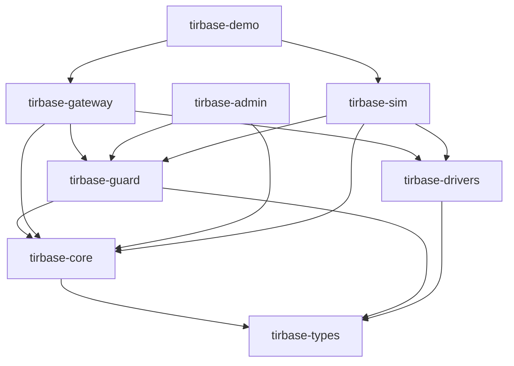

# RFC-workspace: 8-Crate Workspace Layout for TirBase

**Status:** Draft  
**Requirement:** PV-2.9  
**Claim:** [CLAIM-1.1]  
**Merge gate:** No workspace-restructuring changes may be merged until this RFC is committed to the main branch.

---

## Motivation

TirBase is pivoting from an offline-first BaaS for off-grid teams into a hardened edge-node runtime for critical infrastructure. The current single-crate `tirbase-core` bundles the CRDT engine, schema, contamination, auth, store, identity, migration, durability, and transport all together. This creates several problems:

1. **No isolation between guard and device I/O.** There is no compile-time enforcement preventing a driver from bypassing the Command Guard. A single crate cannot enforce the invariant that all actuator writes go through the Guard.

2. **No `no_std`-capable leaf crate.** Shared newtypes (FixedPointValue, ID types, CommandRole) are entangled with `std`-heavy subsystems, making them unavailable to bare-metal or constrained targets.

3. **Circular coupling risk.** Guard logic that should be unaware of driver internals lives next to driver logic that should be unaware of guard policy. Adding a hard dependency rule requires splitting the crate.

4. **Slow incremental builds and large binary footprints.** Every downstream binary pulls in all of tirbase-core even if it only needs types or guard logic.

The 8-crate workspace layout described in this RFC establishes strict dependency edges that are enforced by CI. The key invariant is:

> `tirbase-drivers` depends on `tirbase-types` only. It must never import `tirbase-guard` or `tirbase-core`. This is the compile-time proof that drivers cannot bypass the guard.

No workspace-restructuring changes (moving modules between crates, introducing new crates, or altering the `Cargo.toml` workspace member list) may be merged until this RFC document is committed to the main branch.

---

## Proposed Crate Layout

| Crate | New / Existing | Primary Content |
|---|---|---|
| `tirbase-types` | **New** | Shared newtypes and value types: `FixedPointValue`, `CommandRole`, `DeviceSignature`, `DeviceKeyType`, ID newtypes (`DeltaId`, `Did`, `TargetId`, `MigrationId`, `ProfileId`), `UnitId`, `UnitDescriptor`. `no_std`-capable; only `serde` as an external dependency. |
| `tirbase-core` | Existing (extended) | CRDT engine, schema, contamination, auth, store, identity, migration, durability, diagnostics, transport. Provides `TimeSource`, `KeyProvider`, `MonotonicCounterTrait`, `SecurityEventSink` traits in `src/traits.rs`. |
| `tirbase-guard` | **New** | `CommandGuard`, `EnvelopeProfile`, `PolicyLifecycle`, `AppliedEffectsLedger`, `AntiReplayWindow`, `SingleWriterLease`, `TimeRatchet`, `ActuationPermit`, `SecurityEventLog`. |
| `tirbase-drivers` | **New** | `DriverTrait`, `DeviceModel`, Modbus driver, MQTT bridge driver, cold-room sim driver. Depends on `tirbase-types` **only** — no `tirbase-guard`, no `tirbase-core`. |
| `tirbase-gateway` | **New** | Compiled binary: TOML config, systemd `sd_notify`, Unix-socket admin API, Prometheus metrics. |
| `tirbase-admin` | **New** | CLI with subcommands: `enroll`, `mint`, `rotate`, `push-policy`, `inspect-events`, `simulate`, `rollout`. |
| `tirbase-sim` | **New** | Seeded deterministic simulator: `SimClock`, `ChaCha8Rng`, network fault injection, adversary scenario runner, INV-1..INV-16 tick checks. |
| `tirbase-demo` | **New** | Vertical demo packs: cold-chain, energy-edge, water, logistics, buildings, remote-ops, defense-logistics. |

---

## Dependency Edges

### Table

```
tirbase-types       → (no deps; no_std, serde only)
tirbase-core        → tirbase-types
tirbase-guard       → tirbase-core, tirbase-types
tirbase-drivers     → tirbase-types  (NOT tirbase-guard, NOT tirbase-core)
tirbase-gateway     → tirbase-core, tirbase-guard, tirbase-drivers
tirbase-admin       → tirbase-core, tirbase-guard
tirbase-sim         → tirbase-core, tirbase-guard, tirbase-drivers
tirbase-demo        → tirbase-gateway, tirbase-sim
```

### Mermaid Diagram



### Rationale for Key Edges

**`tirbase-drivers` → `tirbase-types` only**

Drivers are pure codecs: they receive frames on a socket, decode them, encode responses, and send them back. The device file descriptor never crosses the process boundary — the parent guard process owns it. Because drivers are pure codecs that operate on frames, they need only the shared type definitions in `tirbase-types`. They must not import `tirbase-guard` (no guard policy bypass path at compile time) and must not import `tirbase-core` (no CRDT, no auth, no schema). This is the central safety property of the workspace layout.

**`tirbase-guard` → `tirbase-core, tirbase-types`**

The guard evaluates commands against policy (from `tirbase-guard`) using CRDT/auth/identity state (from `tirbase-core`) and shared value types (from `tirbase-types`). The guard does NOT depend on `tirbase-drivers`, ensuring that guard logic is independent of device codec details.

**`tirbase-gateway` → all three**

The gateway binary is the integration point. It wires the guard pipeline to driver processes and exposes the admin API. It is the only crate that legitimately imports all three of `tirbase-core`, `tirbase-guard`, and `tirbase-drivers`.

**`tirbase-types` → (no deps)**

The leaf crate. `no_std`-compatible and depends only on `serde`. This makes shared types available to any target, including bare-metal firmware or WASM sandboxes, without pulling in `std` or any TirBase subsystem.

---

## CI Enforcement

Two dependency invariants are enforced as blocking CI steps (see also task 1.3, CLAIM-1.3, PV-10.3):

### Invariant 1: tirbase-core isolation

```
cargo check -p tirbase-core
```

This check must pass without any `tirbase-guard` or `tirbase-drivers` symbol being imported. If `tirbase-core`'s `Cargo.toml` lists either crate as a dependency, the step fails immediately. A grep-based scan of `tirbase-core/src/` for `tirbase_guard::` or `tirbase_drivers::` token imports is also run as a belt-and-suspenders check.

**Why it matters:** `tirbase-core` provides the CRDT engine, auth, and transport. If it were allowed to import guard or driver symbols, a circular dependency chain would form and the guard bypass property would be weakened.

### Invariant 2: tirbase-drivers isolation

```
cargo check -p tirbase-drivers
```

This check must pass without any `tirbase-guard` or `tirbase-core` symbol being imported. The CI step fails if `tirbase-drivers/Cargo.toml` lists either crate, and a source scan for `tirbase_guard::` or `tirbase_core::` is also run.

**Why it matters:** This is the compile-time proof that drivers cannot access guard state, issue tokens, or read CRDT data. A driver that could import `tirbase-guard` could potentially construct an `ActuationPermit` or bypass the anti-replay window.

### CI Step Placement

Both invariant checks run in the same CI job as `cargo check --workspace` and `cargo test --workspace`, and both are blocking gates — a failed invariant check prevents the merge.

The `.github/workflows/ci.yml` file must include these steps:

```yaml
- name: Check tirbase-core isolation (no guard/driver imports)
  run: |
    cargo check -p tirbase-core
    ! grep -r "tirbase_guard\|tirbase_drivers" tirbase-core/src/

- name: Check tirbase-drivers isolation (no guard/core imports)
  run: |
    cargo check -p tirbase-drivers
    ! grep -r "tirbase_guard\|tirbase_core" tirbase-drivers/src/
```

---

## Migration Notes

### Modules Staying in `tirbase-core`

The following modules remain in `tirbase-core` and are not moved to any other crate:

| Module path | Contents |
|---|---|
| `tirbase-core/src/api/` | `CoreHandle`, `InitConfig` |
| `tirbase-core/src/auth/` | `CapabilityManager`, `RevocationSubsystem`, `RootCaRegistry` |
| `tirbase-core/src/contamination/` | `CausalContaminationEngine`, ICO, taint, resolution |
| `tirbase-core/src/crdt/` | `CrdtEngine`, `Delta`, `ChangesetDag`, `MergeOutcome` |
| `tirbase-core/src/diagnostics/` | `DiagnosticEntry`, `emit_startup_diagnostics` |
| `tirbase-core/src/events.rs` | `SecurityEvent`, `SecurityEventCategory`, `Severity`, `TimeSourceFlag` |
| `tirbase-core/src/durability/` | `DurabilitySubsystem`, cloud ledger, receipts, spatial |
| `tirbase-core/src/identity/` | `IdentityManager`, `derive_did`, `resolve_did` |
| `tirbase-core/src/migration/` | `SchemaMigrationEngine`, `wasm_sandbox`, quarantine, sidecar |
| `tirbase-core/src/schema/` | `Schema`, parser, printer, diff, `SchemaIdentifierHash` |
| `tirbase-core/src/store/` | `LocalStore`, SQLite, IndexedDB, compaction, projection |
| `tirbase-core/src/traits/` | `TimeSource`, `KeyProvider`, `MonotonicCounterTrait`, `SecurityEventSink` |

The `src/traits/` module is new — it is added to `tirbase-core` as part of Phase 1 (tasks 5.1–5.4) to provide the trait definitions that downstream crates (`tirbase-guard`, `tirbase-gateway`) implement or consume.

The `src/events.rs` module is also new — `SecurityEvent` and related types are defined in `tirbase-core` rather than `tirbase-guard` because the `SecurityEventSink` trait in `tirbase-core/src/traits/` references them. Defining the event types in `tirbase-guard` would create a downward dependency (`tirbase-core` → `tirbase-guard`), which is forbidden by Invariant 1 above.

### Types Moving to `tirbase-types`

The following types are extracted from `tirbase-core` into the new `tirbase-types` leaf crate:

| Type | Rationale |
|---|---|
| `FixedPointValue` | Needed by both `tirbase-guard` (envelope checks) and `tirbase-drivers` (device values). Cannot live in `tirbase-core` if drivers must not depend on core. |
| `CommandRole` | Needed by `tirbase-guard` (authorization matrix) and `tirbase-types` consumer sites. |
| `DeviceSignature`, `DeviceKeyType` | Needed by `tirbase-guard` (signature verification) and `tirbase-drivers` (driver identity). |
| `DeltaId`, `Did`, `TargetId`, `MigrationId`, `ProfileId` | ID newtypes used across all crates; must be a shared leaf. |
| `UnitId`, `UnitDescriptor` | Needed by `tirbase-types` FixedPointValue and by drivers for physical value labeling. |

Any type currently defined in `tirbase-core` that is also needed by `tirbase-drivers` MUST be moved to `tirbase-types`. If it were left in `tirbase-core`, drivers would be forced to depend on `tirbase-core`, violating Invariant 2.

### New Types Introduced in `tirbase-guard`

The following types are new and belong exclusively in `tirbase-guard`:

- `CommandGuard`, `ActuationPermit`, `EnvelopeProfile`, `ParameterSpec`, `ParameterKind`
- `LinearConstraint`, `PolicyBundle`, `PolicyBundleKind`, `PolicyLifecycle`, `TrustRootRecord`
- `AppliedEffectsLedger`, `EffectsEntry`, `EffectsState`
- `AntiReplayWindow`, `SingleWriterLease`, `DecidedOutcomeCache`
- `TimeRatchet`, `TimeBeacon`, `FreshnessState`, `ChallengeNonce`
- `SecurityEventLog`
- `SignedOperation<T>`, `SignatureEntry`
- `NodeMode` (unified five-state mode model)

`ActuationPermit` is intentionally `pub(crate)` within `tirbase-guard`. Its private `_sealed: ()` field prevents construction outside the crate. This is the mechanism that makes the guard bypass property compile-fail provable (see PV-4.3, PV-4.4).

### No Modules Move from `tirbase-core` to `tirbase-guard`

The guard crate is entirely new. No existing `tirbase-core` modules are relocated into it. Modules that currently live in `tirbase-core` and are referenced by guard logic are consumed via the public API of `tirbase-core` (through `tirbase-guard`'s declared dependency on `tirbase-core`).

---

## Merge Gate

**Reference: PV-2.9**

> IF the workspace restructure RFC at `docs/RFC-workspace.md` has not been committed to the main branch, THEN no workspace-restructuring changes SHALL be merged.

For the purposes of this rule, "workspace-restructuring changes" means any pull request that:

- Adds, removes, or renames a member crate in the root `Cargo.toml` `[workspace]` section.
- Moves a module or file from one crate to another.
- Adds a new `[dependencies]` entry to any member crate's `Cargo.toml` where the dependency is another workspace member crate.
- Removes an existing `[dependencies]` entry between workspace member crates.
- Changes the `name` field in any member crate's `Cargo.toml`.

This RFC must be merged to the main branch before any such change is proposed. The CI workflow enforces this by checking for the presence of `docs/RFC-workspace.md` on the main branch before allowing workspace-related diffs to merge. The check script is:

```bash
if git diff --name-only origin/main...HEAD | grep -qE '^(Cargo\.toml|[^/]+/Cargo\.toml)$'; then
  if ! git show origin/main:docs/RFC-workspace.md > /dev/null 2>&1; then
    echo "ERROR: Workspace changes require docs/RFC-workspace.md on main branch (PV-2.9)"
    exit 1
  fi
fi
```

---

## Status

**Draft** — This RFC is pending review and merge to the main branch.

Once merged, the status will change to **Accepted** and the merge gate described in PV-2.9 will be satisfied. Subsequent workspace-restructuring changes (task 1.2 and beyond) may then proceed.

---

## Reference

- **Requirement:** PV-2.9 in `.kiro/specs/tirbase-master-enhancement/requirements.md`
- **Design source:** `.kiro/specs/tirbase-master-enhancement/design.md`, section "Workspace / Crate Layout"
- **Claim:** [CLAIM-1.1] — this document's existence on main branch satisfies the claim
- **Related tasks:** 1.2 (scaffold Cargo.toml), 1.3 (CI layering checks)
- **Related CIs:** CLAIM-1.2, CLAIM-1.3
